# Software Project Documentation | توثيق مشروع البرمجيات


---

## 1. Project Overview | نظرة عامة على المشروع

| Field | Value |
|-------|-------|
| **Project Title** | NEO Challenge |
| **Project Type** | Web App |
| **Description** | A gamified challenge platform that helps users build healthy habits through daily challenges in sports, language learning, and general knowledge. Users can join challenges, track their progress, watch exercise videos, take quizes, and follow personalized nutrition plans. |

| **Target Users** | Students and young adults ages 12-25 interested in self-improvement, teachers looking for educational tools, and fitness enthusiasts |

### Tech Stack | Technology Stack

| Category | Technology | Purpose |
|----------|-----------|---------|
| **Language** | Python | Main programming language for the application |
| **Database** | SQLite3 | Stores all data including users, challenges, activities, exercises, muscles, language data, general knowledge, and videos |
| **Libraries** | streamlit | Creates responsive web pages with easy user experience and multi-page navigation |

### Dependencies | المكتبات المستخدمة

| Package | Version | Purpose |
|---------|---------|---------|
| streamlit | 1.64.0 | Creates responsive web pages with easy user experience and multi-page navigation |


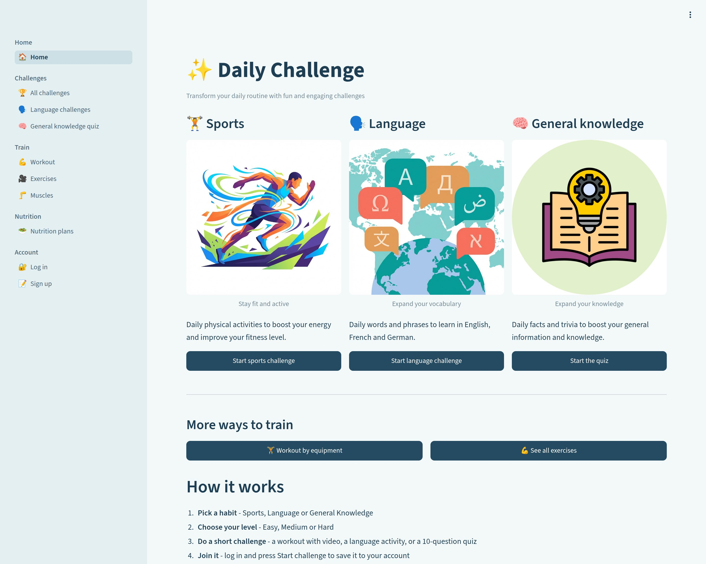

---

## 2. Problem Statement | بيان المشكلة


### What problem does this project solve? | ما المشكلة التي يحلها هذا المشروع؟

Many students and young adults struggle to maintain healthy habits and continuous learning. They lack a unified, engaging platform that combines physical fitness, language learning, and general knowledge improvement. Existing tools are either too complex, focused on only one area, or not designed for the gamified learning experience that motivates young users.

### Why does it matter? | لماذا هذا مهم؟

Poor health habits and lack of continuous learning lead to reduced energy, difficulty concentrating, and missed opportunities for personal growth. A gamified, multi-faceted platform that addresses sports, language, and knowledge can help users build sustainable habits while making learning fun and engaging. This holistic approach supports both physical and mental development.

### How is it currently solved? | كيف تُحل المشكلة حالياً؟

Users currently use separate apps for different needs: fitness apps like MyFitnessPal for workouts, language apps like Duolingo for languages, and quiz apps for knowledge. This fragmented approach is less effective because it lacks integration, doesn't provide a unified progress tracking system, and misses the opportunity for cross-domain motivation.


---

## 3. Technical Architecture | البنية التقنية


### Project Structure | هيكل المشروع

```
neo-challange_database/
├── app.py               
├── app_pages
│   ├── home.py         
│   ├── login.py         
│   ├── sign_up.py       
│   ├── view_challenges.py  
│   ├── challenge_details.py 
│   ├── workout.py       
│   ├── general_knowledge.py 
│   ├── language_challenge.py 
│   ├── my_challenges.py 
│   ├── create_challenge.py  
│   ├── create_activity.py   
│   ├── create_exercise.py   
│   ├── create_muscle.py     
│   ├── create_nutrition_plan.py  
│   ├── view_exercise.py     
│   ├── view_muscles.py      
│   ├── view_nutrition_plan.py 
│   ├── view_users.py     
│   ├── exercise_details.py 
│   └── logout.py        
├── database/            
│   ├── database.db       
│   ├── schema.sql       
│   ├── insert_challenges.sql    
│   ├── insert_activities.sql    
│   ├── insert_exercise.sql      
│   ├── insert_muscles.sql       
│   ├── insert_nutrition_plan.sql 
│   └── insert_general_knowledge.sql 
├── assets/              
│   ├── config.py        
│   └── [various images for UI]
├── docs/                
│   └── afro_asian_software_template.md
├── requirements.txt     
├── README.md            
├── .streamlit/          
└── .gitignore          
```

### Architecture Diagram | مخطط البنية

```
[Student] → [Streamlit Browser] → [Python Backend] → [SQLite Database]
```

### Key Files | الملفات الرئيسية

| File | Purpose | Lines of Code |
|------|---------|:-------------:|
| app.py | Main entry point - sets up Streamlit app, creates database tables, defines navigation menu | ~83 |
| database/schema.sql | Database schema - defines all tables (users, challenges, activities, exercises, muscles, nutrition plans) | ~130 |
| app_pages/home.py | Landing page - displays three main challenge categories (Sports, Language, General Knowledge) | ~44 |
| assets/config.py | Shared configuration - database path, category images, level icons used across pages | ~26 |
| app_pages/view_challenges.py | Challenges browser - displays all challenges in a grid layout with activity counts | ~36 |

---

## 4. Features & User Flow | الميزات وتدفق المستخدم

### Feature List | قائمة الميزات

| # | Feature | Description | Status |
|---|---------|-------------|:------:|
| 1 | User Authentication | User registration and login with email/password, admin role assignment | ✅ |
| 2 | Sports Challenges | Daily physical activities with exercise videos and difficulty levels (Easy/Medium/Hard) | ✅ |
| 3 | Language Challenges | Language learning activities for English, French, and German with vocabulary and phrases | ✅ |
| 4 | General Knowledge Quiz | Interactive quiz system with multiple-choice questions at different difficulty levels | ✅ |
| 5 | Exercise Library | Browse exercises by equipment type (Machine, Free Weights, Bodyweight, Cable) with video demonstrations | ✅ |
| 6 | Muscle Information | Detailed muscle anatomy with descriptions, locations, functions, and difficulty to train | ✅ |
| 7 | Nutrition Plans | Personalized nutrition recommendations based on BMI categories with meal plans | ✅ |
| 8 | Progress Tracking | Track completed activities, exercises, and quiz scores over time | ✅ |
| 9 | My Challenges | View and manage joined challenges with progress indicators | ✅ |
| 10 | Admin Panel | Create and manage challenges, activities, exercises, muscles, and nutrition plans | ✅ |

> Status: ✅ Complete | ⏳ In Progress | ❌ Not Started

### User Flow | تدفق المستخدم

```
                    ┌──────────────┐
                    │   LANDING    │
                    │   (home.py)  │
                    └──────┬───────┘
                       │   │   │
            ┌──────────┘   │   └──────────────┐ ────────────────────┐                                     
      user/register ┌──────▼───────┐        workout                nutrition plan
                    │     all      │                                                
                    │   challenges │  exercise       muscles
                    │              │        
                    └──────┬───────┘
                           │
                    ┌──────▼───────┐
                    │   challenge  │
                    │    details   │
                    │              │
                    └──┬───┬───┬───┘
                       │   │   │
              ┌────────┘   │   └────────┐
              ▼            ▼            ▼
        ┌──────────┐ ┌──────────┐ ┌──────────┐
        │  sport   │ │ language │ │ General  │
        │challenge │ │ challenge│ │ knowledge│
        └──────────┘ └──────────┘ └──────────┘
```

### Screen Reference | دليل الشاشات

| Screen | File / Route | Description | Transitions To |
|--------|-------------|-------------|----------------|
| Landing | app_pages/home.py | Welcome page with three challenge categories (Sports, Language, General Knowledge) | Login, Sign up, View challenges, Language challenge, General knowledge, Workout, View exercises |
| Login | app_pages/login.py | User authentication with email and password | Home (after login) |
| Sign up | app_pages/sign_up.py | User registration with personal details (username, email, password, phone, birth date, height, weight) | Login |
| All Challenges | app_pages/view_challenges.py | Grid view of all challenges with category, duration, and activity count | Challenge details |
| Challenge Details | app_pages/challenge_details.py | Shows challenge activities with difficulty levels, allows users to join challenges | My challenges |
| Workout | app_pages/workout.py | Choose equipment type (Machine, Free Weights, Bodyweight, Cable) to filter exercises | View exercises |
| View Exercises | app_pages/view_exercise.py | Display exercises with videos and thumbnails, filtered by equipment | Exercise details |
| Exercise Details | app_pages/exercise_details.py | Shows exercise video, description, muscle target, and difficulty | Back to exercises |
| Language Challenge | app_pages/language_challenge.py | Language learning activities for English, French, German | Home |
| General Knowledge | app_pages/general_knowledge.py | Quiz with questions at Easy/Medium/Hard levels | Home |
| Nutrition Plans | app_pages/view_nutrition_plan.py | Display nutrition plans based on BMI categories with meal recommendations | Home |
| My Challenges | app_pages/my_challenges.py | Shows challenges the user has joined and their progress | Challenge details |


---

## 5. UI/UX Design | تصميم واجهة المستخدم
>

### Screenshots | لقطات الشاشة

<!-- Screenshot: Landing page -->
**Landing Page**: 

<!-- Screenshot: Main dashboard -->
**Challenges View**: 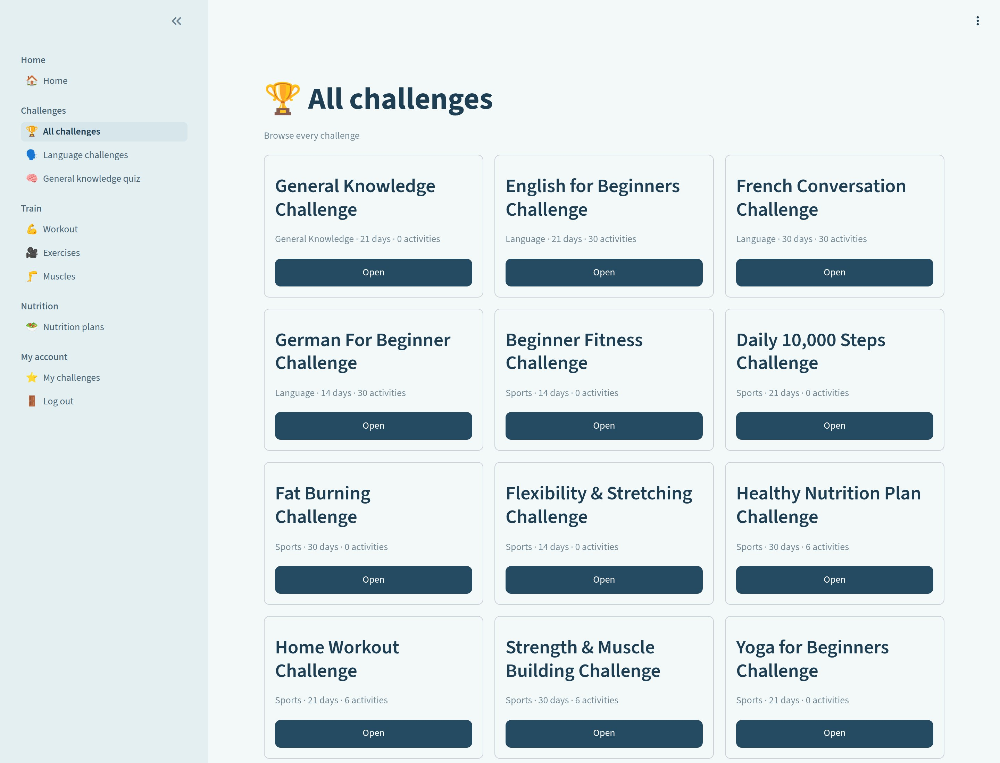

<!-- Screenshot: Key feature screen -->
**Nutrition Plans**: 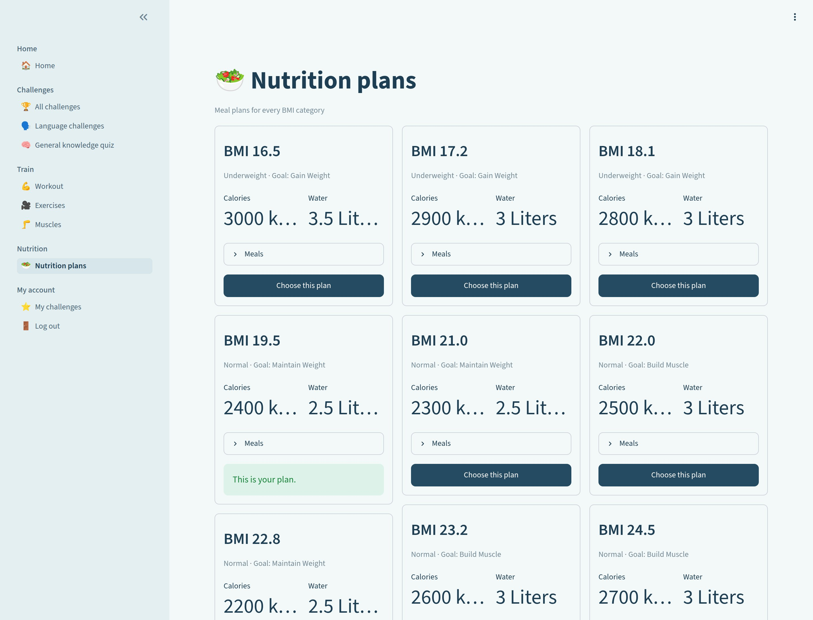

<!-- Screenshot: Workout page -->
**Workout**: 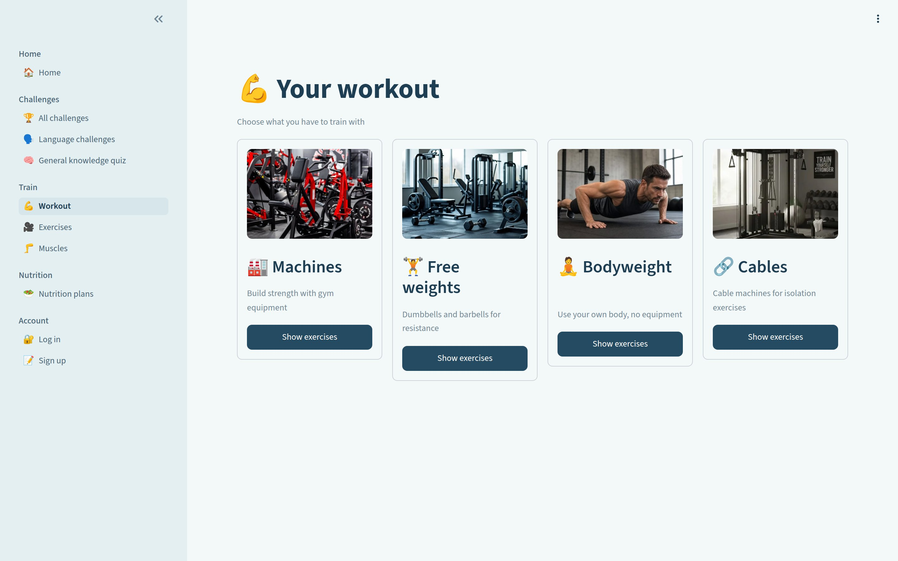

<!-- Screenshot: Exercises view -->
**Exercises**: 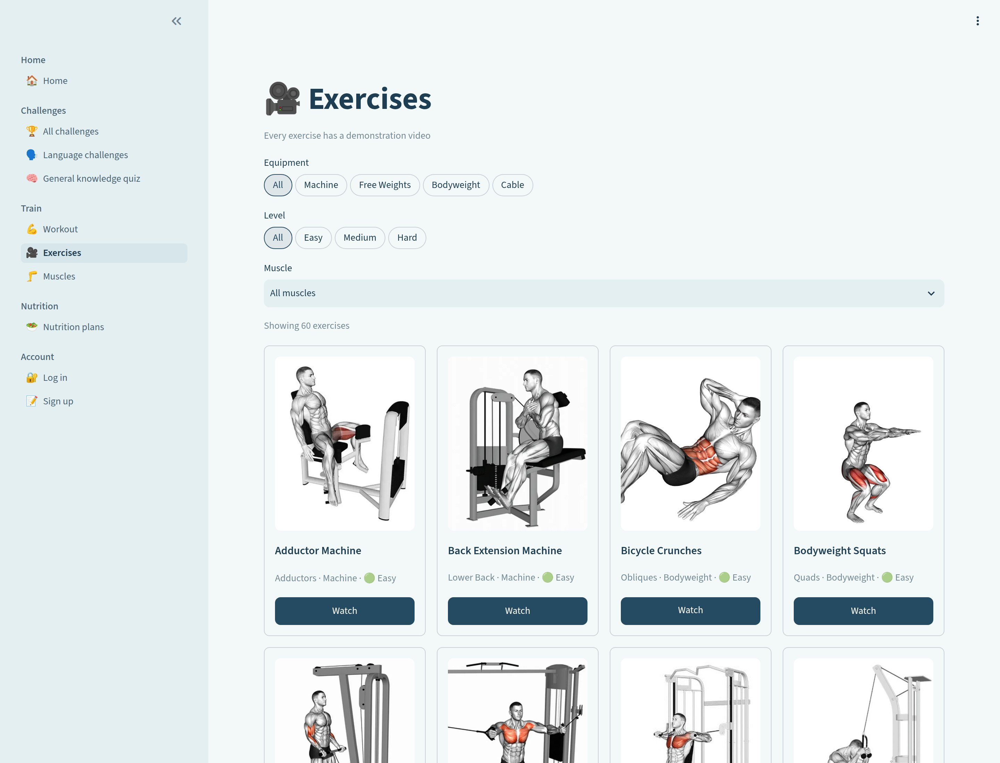

<!-- Screenshot: Language challenge -->
**Language Challenge**: 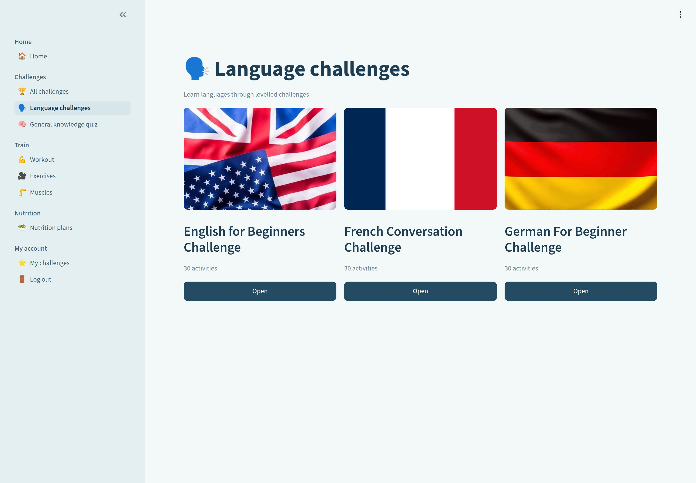

<!-- Screenshot: Quiz -->
**Quiz**: 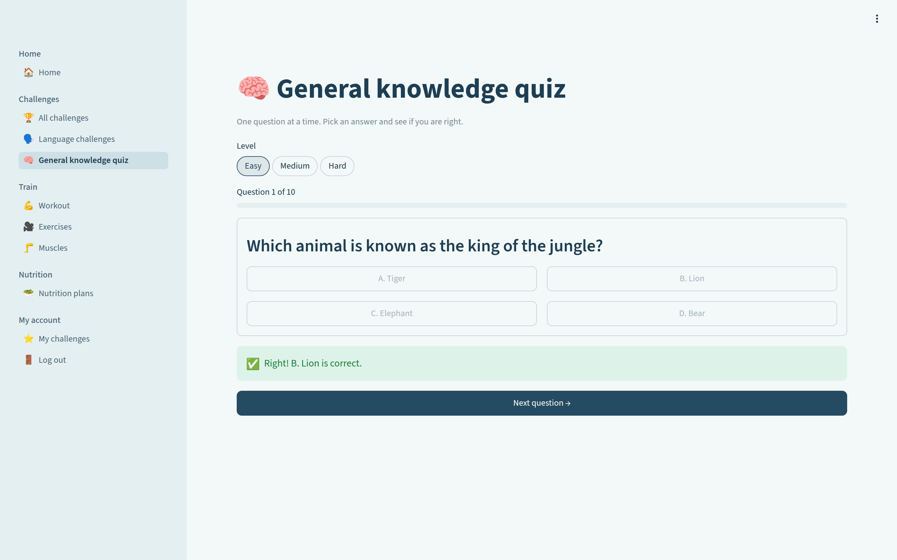

<!-- Screenshot: My challenges -->
**My Challenges**: 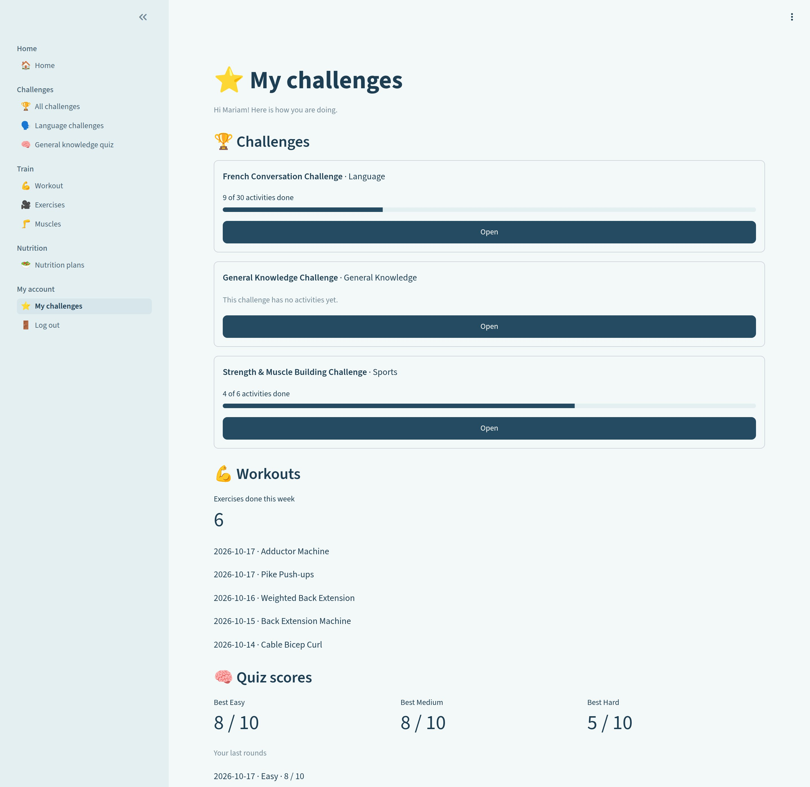

<!-- Screenshot: Muscles -->
**Muscles**: 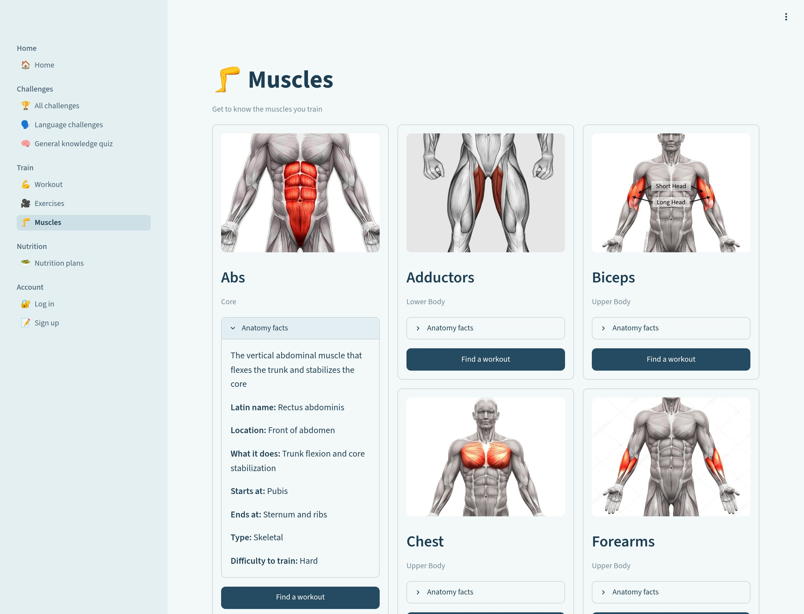

<!-- Screenshot: Challenge details -->
**Challenge Details**: 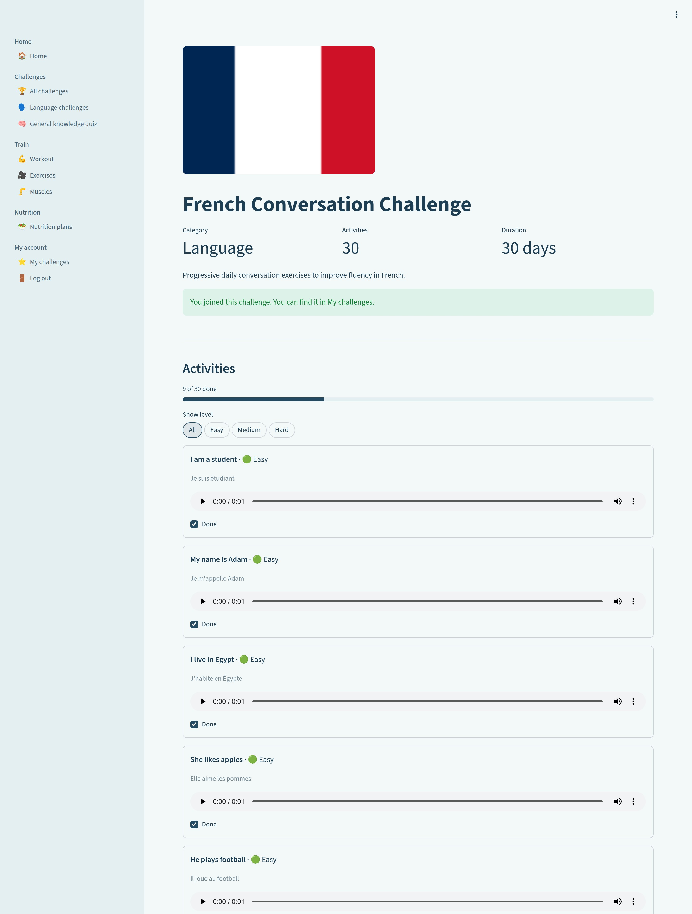

<!-- Screenshot: Quiz result -->
**Quiz Result**: 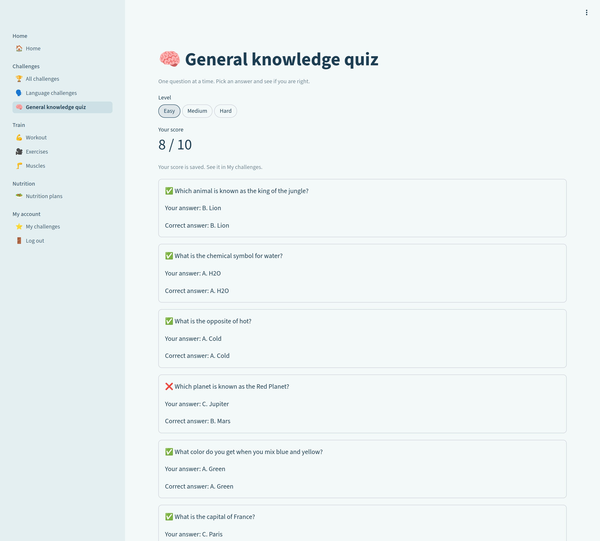

### Design System

| Element | Style |
|---------|-------|
| **Primary Color** | Teal blue (#254B62) |
| **Background Color** | Light gray-blue (#F3F8F9) |
| **Secondary Background** | Light teal (#E4EFF2) |
| **Text Color** | Dark teal (#1D3E53) |
| **Font** | Default Streamlit font (sans-serif) |
| **Button Style** | Rounded buttons with full-width containers |
| **Layout** | Multi-page navigation with sidebar, card-based content display |

### Responsive Design

| Breakpoint | Layout | Tested? |
|------------|--------|:-------:|
| Desktop (1024px+) | Full sidebar navigation + multi-column grid layouts (3-4 columns) | ☑ |
| Tablet (768-1024px) | Collapsible sidebar + 2-column grid layouts | ☐ |
| Mobile (< 768px) | Stacked single-column layout, full-width cards | ☐ |

---

## 6. Data Sources | مصادر البيانات

<div class="arabic">
هنا تكتب منين جبت الداتا — قاعدة بيانات، API، ملفات، أو داتا مكتوبة في الكود
</div>

### Data Sources | مصادر البيانات

| Source | Type | Description |
|--------|------|-------------|
| database/database.db | SQLite Database | Stores all user data, challenges, activities, exercises, muscles, nutrition plans, quiz results |
| database/schema.sql | SQL Schema File | Defines database table structure and relationships |
| database/*.sql files | SQL Seed Files | Initial data for challenges, activities, exercises, muscles, nutrition plans, general knowledge |
| User Input | Form Submissions | User registration, challenge joining, activity completion, quiz answers |
| Streamlit Session | Session State | Current logged-in user, selected challenge, equipment filters |
| assets/ | Static Files | Images for UI (category icons, muscle images, thumbnails) |
| videos/ | Video Files | Exercise demonstration videos |

### Database Schema | مخطط قاعدة البيانات

| Table | Columns | Description |
|-------|---------|-------------|
| users | id, username, email, password, birth_date, height, weight, phone, ssn, is_admin | User accounts with personal details and admin status |
| challenges | id, name, category, duration, description | Challenge definitions (Sports, Language, General Knowledge) |
| activities | id, challenge_id, name, description, difficulty, exercise_id | Activities within challenges, linked to optional exercises |
| questions | id, challenge_id, question, option_a, option_b, option_c, option_d, correct_answer, level | Quiz questions for General Knowledge challenges |
| user_challenges | user_id, challenge_id | Which users joined which challenges |
| nutrition_plans | id, bmi, category, goal, calories, breakfast, lunch, dinner, water_intake | Nutrition plans based on BMI categories |
| user_nutrition_plans | user_id, nutrition_plan_id | Each user's selected nutrition plan |
| muscles | id, name, latin_name, description, muscle_group, location, function, origin, insertion, muscle_type, difficulty_to_train, image_url, video_url | Muscle information with anatomical details |
| exercises | id, muscle_id, name, description, equipment, difficulty, video_url, thumbnail_url | Exercise demonstrations linked to muscles |
| user_activities | user_id, activity_id, done_at | Progress tracking: activities completed by users |
| exercise_logs | user_id, exercise_id, done_on | Progress tracking: exercises done by users per day |
| quiz_results | id, user_id, level, score, total, played_at | Quiz results and scores |


## 7. Educational Content | المحتوى التعليمي

<div class="arabic">
هنا تكتب المحتوى التعليمي — ماذا يتعلم الطالب من هذا المشروع؟ كيف يتعلق بالمنهج؟
</div>

### Learning Objectives | أهداف التعلم

By the end of this project, the student will be able to:

1. [fill in — e.g., Build a full-stack web application with Python]
2. [fill in — e.g., Design and query a SQLite database]
3. [fill in — e.g., Create responsive UI with HTML/CSS]
4. [fill in — e.g., Implement user authentication]
5. [fill in]

### Cultural / Historical Context | السياق الثقافي / التاريخي

| Topic | Description |
|-------|-------------|
| Health & Wellness | Promotes healthy habits through sports challenges and nutrition planning, addressing modern sedentary lifestyles |
| Multilingual Learning | Language challenges support English, French, and German, fostering cultural exchange and language skills |
| General Knowledge | Quiz system encourages continuous learning across various subjects |


---

## 8. Marketing Plan | خطة تسويقية

> **Short version** — for full marketing plans, use the main Afro-Asian template.

<div class="arabic">
نسخة مختصرة — للخطط التسويقية الكاملة، استخدم القالب الرئيسي
</div>

### Target Audience | الجمهور المستهدف

- **Primary**: Students and young adults ages 12-25 interested in self-improvement through daily challenges in sports, language, and general knowledge
- **Secondary**: Teachers and educators looking for engaging educational tools for their students
- **Tertiary**: Fitness enthusiasts, language learners, and coding communities interested in gamified learning

### Platforms | المنصات

- Web browser (Chrome, Firefox, Edge, Safari) - desktop and mobile responsive
- School computer labs and educational institutions
- Personal laptops and tablets

### Promotion Ideas | أفكار ترويجية

1. Share demo video on YouTube/TikTok showing the challenge features
2. Present at school science fair or educational exhibition
3. Post screenshots and features on class WhatsApp/Telegram groups
4. Submit to Afro-Asian Tech Forum competition - Educational Tools category
5. Create social media posts highlighting success stories of users completing challenges

---

## 9. Student Worksheet | ورقة عمل الطالب

> **Instructions**: Copy this section into your own document and fill it in for YOUR project.

---

### My Project Information | معلومات مشروعي

**Student Name**: osama abdelghany, mohamed abdelghany

**Project Title**: Neo challenge


---


### My Data | بيانات مشروعي

**Where does data come from?**

_______________________________________________

**What data is stored?**

_______________________________________________

---

### What I Learned | ما تعلمته

1. The hardest part of building my project was: writing database tables sql

2. The most fun part of building my project was: recording videos of the exercises

3. If I had more time, I would add: add more languages and more video types

4. One thing I would do differently: 

---

---


---

<div class="session-footer">
  <p>Techno Kids, Techno Future — Software Documentation Template</p>
  <p>Afro-Asian Tech Forum · Software Category · 2026</p>
</div>
