# Software Project Documentation

**NEO Challenge — Daily Challenge**
*One app, three daily habits: train your body, grow your languages, sharpen your mind.*

---

## 1. Project Overview

| Field | Value |
|-------|-------|
| **Project Title** | NEO Challenge |
| **Project Type** | Web App (Python + Streamlit) |
| **Description** | NEO Challenge is a free web app that puts three small daily habits in one place: sports challenges, language activities (English, French, German) and a general knowledge quiz. A student picks a challenge, joins it, does a short activity, and comes back tomorrow. It also has a workout and exercise library with 60 demonstration videos, a muscle explorer, and nutrition plans by BMI category. |
| **Target Users** | Primary: students aged 12-18. Secondary: teachers, parents and schools. Tertiary: sports clubs and youth / language centres. |
| **Resolution / Platform** | Runs in any modern browser. Desktop-first wide layout, tested at 1440x900. Streamlit columns stack on narrow widths, so mobile is partially tested. |
| **Date** | October 2026 |

### Tech Stack

| Category | Technology | Purpose |
|----------|-----------|---------|
| **Language** | Python 3 | All application logic: screens, database queries, the menu |
| **Framework** | Streamlit 1.64 | Builds every screen, the menu (`st.navigation`) and remembers who is logged in (`st.session_state`) |
| **Database** | SQLite via Python's built-in `sqlite3` | Stores users, challenges, activities, questions, muscles, exercises and nutrition plans in `database/database.db` |
| **Libraries** | Streamlit only | `requirements.txt` contains exactly one package, `streamlit==1.64.0`. `sqlite3` and `datetime` come with Python. |
| **Styling** | Streamlit theme (`.streamlit/config.toml`) | One teal colour palette for the whole app, no custom CSS |

### Dependencies

| Package | Version | Purpose |
|---------|---------|---------|
| streamlit | 1.64.0 | The whole user interface: widgets, menu, session state, video playback |

> No other third-party package is needed. SQLite is built into Python, which is why the whole app runs offline with a single install.

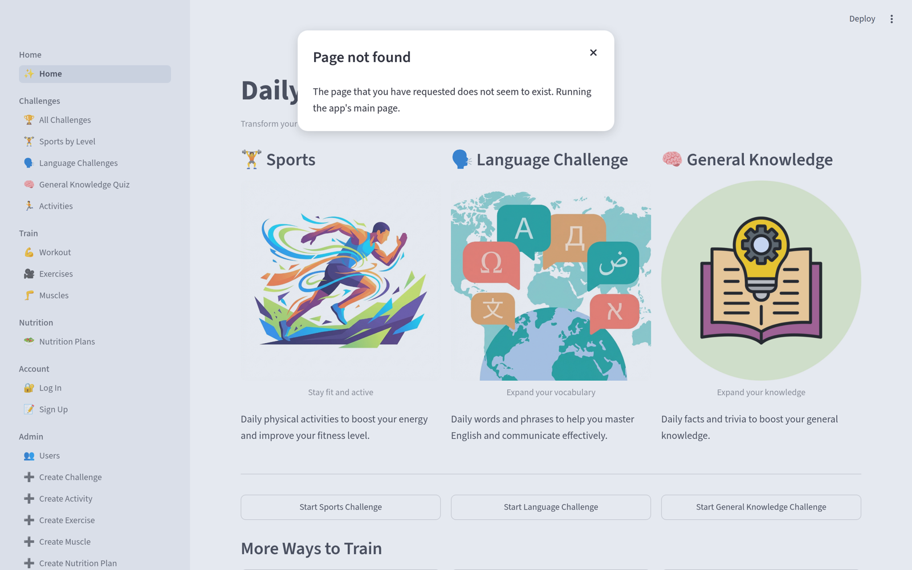

---

## 2. Problem Statement

### What problem does this project solve?

Teenagers who want to improve themselves usually spread their effort across several separate apps: a generic fitness tracker for the gym, a language app for vocabulary, and a quiz app for trivia. Each one is built for adults, most are full of ads or paywalls, and none of them help a young person keep a *small* daily habit going. NEO Challenge gives a student one simple, free place to build three small habits a day: train the body, grow the languages, and sharpen the mind.

### Why does it matter?

Students aged 12-18 are exactly the age group that most needs daily movement, language practice and mental stimulation, and the age group for whom a habit is easiest to build when it is short and in one place. Without one place to return to, effort never becomes a habit. Teachers and parents have the same problem from the other side: there is no free tool they can recommend without an adult account.

### How is it currently solved?

Students use separate apps (generic fitness trackers, language-learning apps, trivia apps) or simply follow YouTube workout videos with no structure. The separate apps are designed for adults, are ad-heavy or overwhelming, and cost money. The YouTube route has no plan, no levels and no way to remember what you joined. Neither route puts the three habits together.

---

## 3. Technical Architecture

### Project Structure

```
neo_challenge_database/
├── app.py                      # Creates the database, builds the menu (82 lines)
├── requirements.txt            # One dependency: streamlit==1.64.0
├── README.md                   # How it works, how to run it, Limits
├── .streamlit/config.toml      # The app's colours
├── assets/
│   ├── config.py               # Database path, pictures, level icons
│   ├── thumbnails/             # A picture from each exercise video
│   └── *.jpg / *.png / *.webp  # Category, flag, muscle and equipment pictures
├── app_pages/                  # 21 screens, one plain script each
│   ├── home.py                 # Home: the three habits
│   ├── view_challenges.py      # All challenges
│   ├── language_challenge.py   # English / French / German challenges
│   ├── challenge_details.py    # One challenge: join it, activities by level
│   ├── general_knowledge.py    # Quiz: level, 10 random questions, score
│   ├── workout.py              # Pick your equipment
│   ├── view_exercise.py / exercise_details.py   # Exercises + video
│   ├── view_muscles.py         # Muscles with anatomy facts
│   ├── view_nutrition_plan.py  # Nutrition plans, choose your plan
│   ├── my_challenges.py        # What you joined and your plan
│   ├── login.py / sign_up.py / logout.py
│   ├── view_users.py           # Admin: everyone who signed up
│   └── create_*.py             # Admin: add challenges, activities, exercises,
│                               #        muscles and nutrition plans
├── database/
│   ├── schema.sql              # The 12 tables, with their rules
│   └── insert_*.sql            # Our starting content
├── videos/                     # 60 exercise demonstration clips (.mp4)
└── docs/
    ├── neo_challenge_documentation.md
    └── screenshots/            # 12 screenshots used in this document
```

### Architecture Diagram

```
   [ Browser ]
       |
       v
   [ Streamlit server ]
       |
       +---> app.py
       |       1. creates the tables (schema.sql) and, if empty,
       |          fills them with our content (insert_*.sql)
       |       2. builds the menu for this visitor:
       |          logged out / logged in / admin
       |
       +---> app_pages/*.py   (21 screens)
       |       each opens the database, reads or writes with SQL, closes it
       |
       +---> [ SQLite: database/database.db ]
       |
       +---> [ Media ]  assets/ (pictures)   videos/ (60 .mp4 clips)
```

In plain words: one Python process serves every screen. `app.py` sets everything up when the app starts, so nobody has to run a separate setup script, and the menu only shows the screens you are allowed to open. Each screen is one short file that talks to the database with plain SQL and passes the selected challenge or exercise to the next screen through `st.session_state`.

### Key Files

| File | Purpose | Lines of Code |
|------|---------|:-------------:|
| app.py | Creates the tables, fills an empty database with our content, and builds the menu: Log in / Sign up when logged out, My challenges / Log out when logged in, Admin only for the admin. | 82 |
| app_pages/challenge_details.py | The busiest screen. Shows one challenge, counts its activities, lets a logged-in student join it, and filters the activities by Easy / Medium / Hard. | 85 |
| app_pages/general_knowledge.py | The quiz. Picks 10 random questions for the chosen level, shows them one at a time with right or wrong straight away, then the score and a ✅ / ❌ review, and saves the round for logged-in students. | 132 |
| app_pages/view_nutrition_plan.py | Nutrition plans by BMI; a logged-in student can choose one plan. | 57 |
| app_pages/sign_up.py | Creates an account. Checks for empty fields and a used email; the very first person to sign up becomes the admin. | 49 |
| app_pages/view_exercise.py | The exercise library, filtered by equipment. | 44 |
| app_pages/workout.py | Four equipment cards that open the filtered exercise library. | 26 |
| database/schema.sql | The 12 tables with their foreign keys and `CHECK` rules. | 129 |

---

## 4. Features & User Flow

### Feature List

| # | Feature | Description | Status |
|---|---------|-------------|:------:|
| 1 | Home hub | One landing screen with three habit cards (Sports, Language, General knowledge) and shortcuts to Workout and Exercises. | ✅ |
| 2 | Challenge browser | All 7 challenges as cards with category, duration and a live count of their activities. | ✅ |
| 3 | Challenge page with level filter | Details, metrics and the challenge's activities, filtered by All / Easy / Medium / Hard. | ✅ |
| 4 | Join a challenge | A logged-in student presses "Start challenge" to save it; logged-out visitors see "Log in to join this challenge." | ✅ |
| 5 | Language challenges | English for Beginners, French Conversation and German Grammar, each with 6 levelled activities. | ✅ |
| 6 | General knowledge quiz | Choose a level, then answer 10 random questions one at a time with a progress bar; each answer shows right or wrong straight away, and the end shows the score and a ✅ / ❌ review. | ✅ |
| 7 | Workout by equipment | Machines, Free weights, Bodyweight and Cables cards that open the matching exercises. | ✅ |
| 8 | Exercise library with videos | All 60 exercises have a picture taken from their video, a demonstration video, the muscle they train, the equipment and the difficulty; filter by equipment, level and muscle. | ✅ |
| 9 | Muscle explorer | 15 muscles with pictures and an "Anatomy facts" section (Latin name, location, what it does, and more). | ✅ |
| 10 | Nutrition plans | 15 plans across Underweight, Normal, Overweight and Obese with calories, meals and water; a student can choose one. | ✅ |
| 11 | My challenges (progress) | A dashboard: a progress bar for every joined challenge, exercises done this week, best quiz score per level, recent rounds and the chosen nutrition plan. | ✅ |
| 12 | Sign up / log in / log out | Student accounts; the menu changes to show only what you can open. | ✅ |
| 13 | Admin pages | The first person to sign up is the admin and can see all users and add challenges, activities, exercises, muscles and nutrition plans. | ✅ |
| 14 | Password hashing | Passwords are stored in plain text today. | ⏳ |
| 15 | Progress tracking | Tick activities Done on a joined challenge, log an exercise once a day, and save every quiz round. | ✅ |
| 16 | Activities for Sports challenges | 6 activities per Sports challenge; the workout ones open the matching exercise video. | ✅ |
| 17 | Public deployment | Putting the app online so any school can open it without installing Python. | ⏳ |

> Status: ✅ Complete | ⏳ In Progress | ❌ Not Started

**Known limitations** (the full list is in `README.md` under Limits): passwords are stored in plain text; the app has no error-handling code beyond friendly checks for empty fields and used emails or names; progress has no reminders or day-in-a-row streaks yet; and the app is not deployed publicly.

### User Flow

```
                              ┌──────────────┐
                              │     Home     │
                              └──────┬───────┘
        ┌──────────────┬─────────────┼──────────────┬──────────────┐
        ▼              ▼             ▼              ▼              ▼
 ┌────────────┐ ┌────────────┐ ┌──────────┐ ┌────────────┐ ┌──────────────┐
 │    All     │ │  Language  │ │   Quiz   │ │  Workout   │ │  Exercises   │
 │ challenges │ │ challenges │ │          │ │ (equipment)│ │              │
 └─────┬──────┘ └─────┬──────┘ └────┬─────┘ └─────┬──────┘ └──────┬───────┘
       └──────┬───────┘             ▼             └───────┬────────┘
              ▼              ┌────────────┐               ▼
      ┌───────────────┐      │  Score +   │       ┌───────────────┐
      │   Challenge   │      │  ✅ / ❌    │       │   Exercise    │
      │ (join, levels)│      │  review    │       │  video + info │
      └───────┬───────┘      └────────────┘       └───────────────┘
              ▼
      ┌───────────────┐
      │ My challenges │   (logged in: your progress dashboard)
      └───────────────┘

 The sidebar menu is always there. It shows Log in / Sign up when you are logged out,
 My challenges / Log out when you are logged in, and the Admin pages only to the admin.
```

### Screen Reference

| Screen | File | Description | Transitions To |
|--------|------|-------------|----------------|
| Home | app_pages/home.py | "Daily Challenge" headline, three habit cards, "More ways to train" | All challenges, Language challenges, Quiz, Workout, Exercises |
| All challenges | app_pages/view_challenges.py | Every challenge with category, duration and activity count | Challenge |
| Language challenges | app_pages/language_challenge.py | English, French and German challenge cards with flags | Challenge |
| Challenge | app_pages/challenge_details.py | Picture, metrics, description, join button, activities by level | Quiz (General Knowledge only) |
| General knowledge quiz | app_pages/general_knowledge.py | Level pills, one question at a time, score and review | Play again on the same screen |
| Workout | app_pages/workout.py | Four equipment cards | Exercises (filtered) |
| Exercises | app_pages/view_exercise.py | Equipment and level pills, muscle filter, picture cards | Exercise |
| Exercise | app_pages/exercise_details.py | Muscle, equipment, difficulty, description and video | Exercises |
| Muscles | app_pages/view_muscles.py | Muscle pictures with "Anatomy facts" | Workout |
| Nutrition plans | app_pages/view_nutrition_plan.py | Plan cards with meals; "Choose this plan" when logged in | Stays on the page |
| My challenges | app_pages/my_challenges.py | Progress dashboard: challenges, workouts, quiz scores, nutrition plan | Challenge |
| Log in / Sign up / Log out | app_pages/login.py, sign_up.py, logout.py | Accounts | The menu changes |
| Users, Create … (admin) | app_pages/view_users.py, create_*.py | User list and forms to add content | — |

---

## 5. UI/UX Design

### Screenshots

**Home**: the three habits, each with one button, plus shortcuts to Workout and Exercises.


**Workout by equipment**: one card per equipment type.

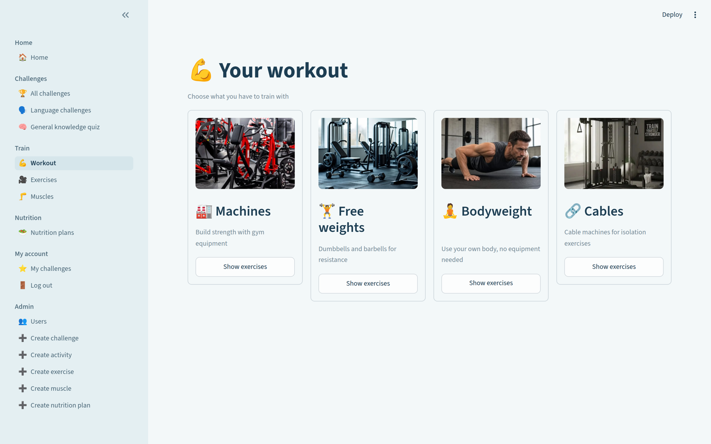

**Exercise library**: filter pills for equipment and level, a muscle filter, and a picture from each video on its card.

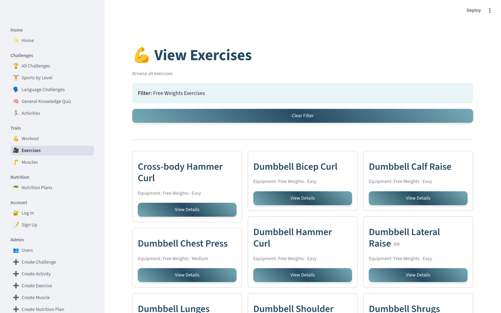

**Exercise video**: the muscle trained, the equipment, the difficulty, a coaching tip and the video.

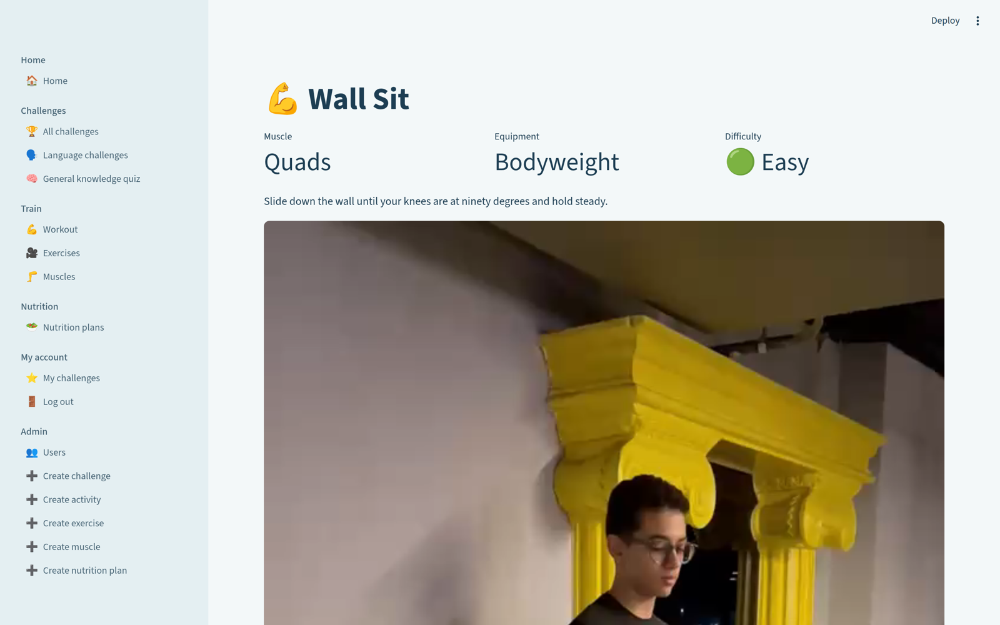

**Muscles**: pictures with an "Anatomy facts" section that opens on click.

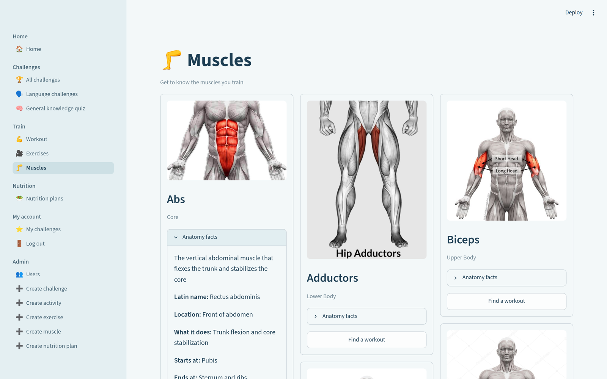

**Language challenges**: English, French and German with their flags.

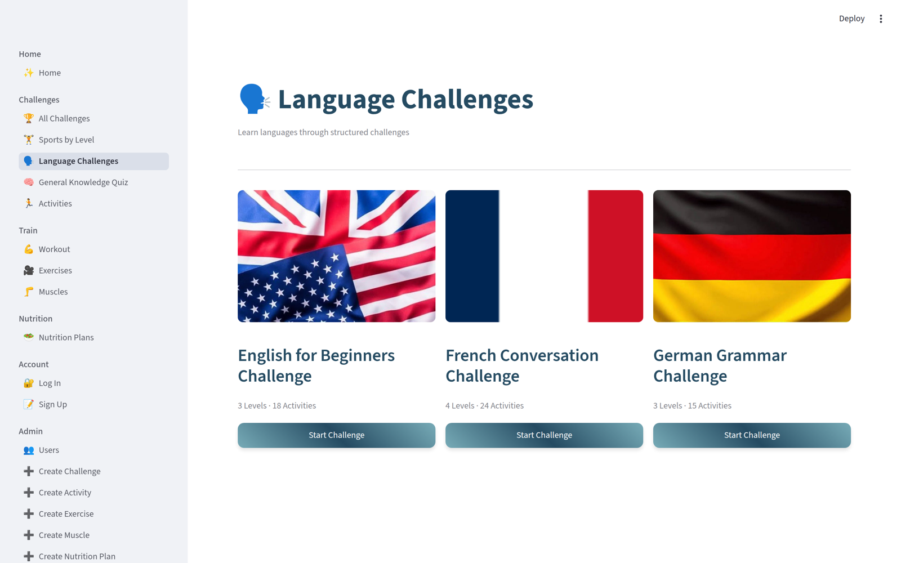

**Challenge**: metrics, the description, the joined message and the activities with their level.

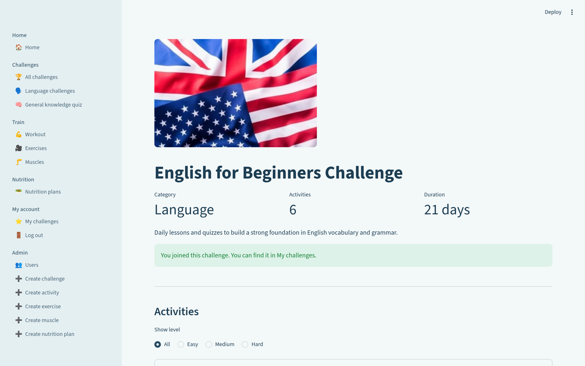

**Quiz**: one question at a time, with a progress bar and right or wrong straight away.

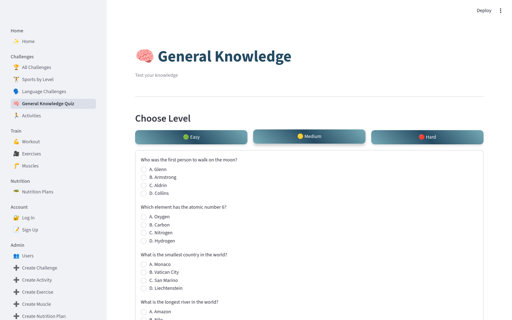

**Quiz result**: the score and a review of every answer.

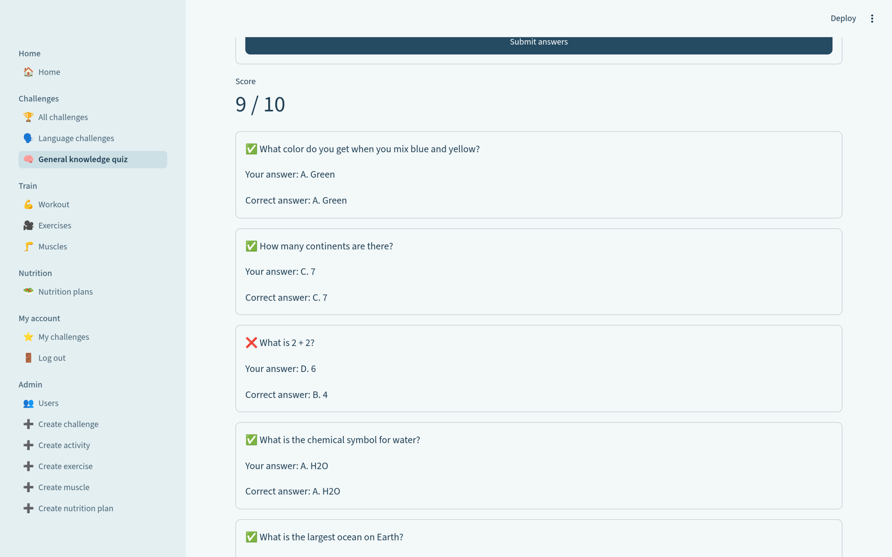

**Nutrition plans**: calories, water and meals, with the student's chosen plan marked.

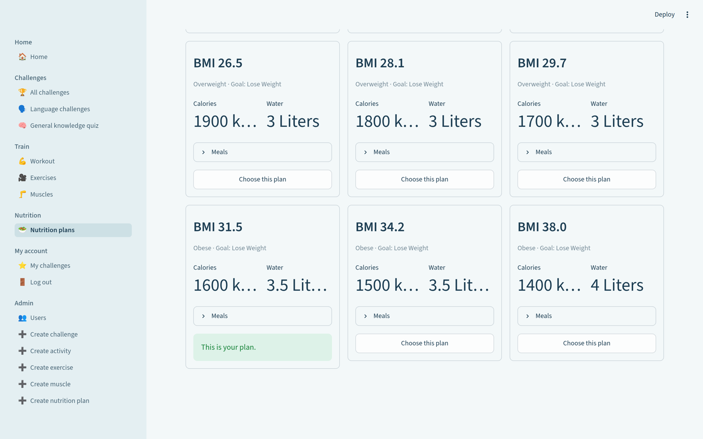

**My challenges**: the progress dashboard, with challenge progress bars, exercises done this week and quiz scores.

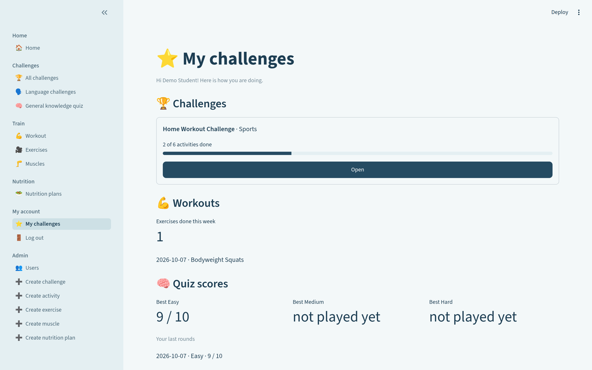

**All challenges**: every challenge with its category, duration and activity count.

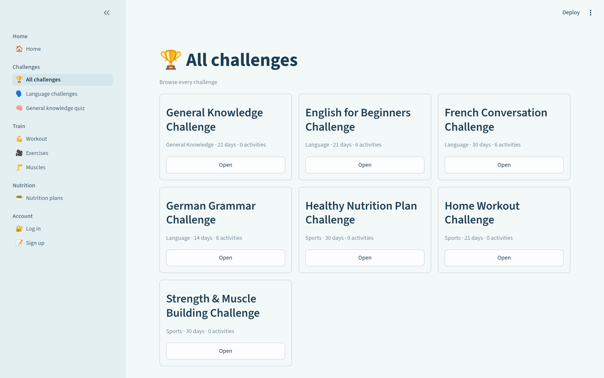

### Design System

The colours are set once in `.streamlit/config.toml`, so every screen matches without any custom CSS.

| Element | Style |
|---------|-------|
| **Primary Colour** | `#254B62`: highlighted buttons and selected options |
| **Background** | `#F3F8F9` (main) and `#E4EFF2` (sidebar) |
| **Text** | `#1D3E53` |
| **Level Icons** | 🟢 Easy · 🟡 Medium · 🔴 Hard, so the level is readable without relying on colour alone |
| **Font** | Streamlit's default sans-serif |
| **Buttons** | Every button is the same filled teal and full width, so the app looks the same everywhere |
| **Cards** | Streamlit bordered containers |
| **Layout** | Wide layout with a grouped sidebar menu (Home / Challenges / Train / Nutrition / Account or My account / Admin) |

### Responsive Design

| Breakpoint | Layout | Tested? |
|------------|--------|:-------:|
| Desktop (1440x900) | Wide layout, sidebar menu, two- and three-column card grids | ✅ |
| Tablet (768-1024px) | Same layout with narrower columns | ☐ |
| Mobile (< 768px) | Streamlit stacks the columns so each card takes the full width; checked only briefly | ⚠️ Partially |

---

## 6. Data Sources

### Data Sources

| Source | Type | Description |
|--------|------|-------------|
| `database/database.db` | SQLite Database | Created by the app when it starts; holds everything below |
| `database/insert_*.sql` | Static (SQL files) | Our starting content: 7 challenges, 36 activities (18 language, 18 sports), 60 trivia questions, 15 muscles, 60 exercises, 15 nutrition plans |
| Sign up form | User Input | Username, email, password, phone, date of birth, height, weight |
| Start challenge / Choose this plan | User Input | Saved in `user_challenges` and `user_nutrition_plans` |
| Admin forms | User Input | New challenges, activities, exercises, muscles and nutrition plans |
| Progress | User Input | Ticked activities (`user_activities`), exercises done (`exercise_logs`) and finished quiz rounds (`quiz_results`) |
| `assets/` | Static (images) | Category art, flags, muscle pictures, equipment photos |
| `videos/` | Static (.mp4) | 60 exercise demonstration clips, one per exercise |

There are **no external APIs**: no accounts to create, no keys to store, and nothing that breaks when another service is down.

### Database Schema

| Table | Columns | Description |
|-------|---------|-------------|
| `users` | id, username, email, password, birth_date, height, weight, phone, ssn, is_admin, created_at | Student accounts; email is unique; the first account has `is_admin = 1` |
| `challenges` | id, name, category, duration, description, created_at | 7 challenges: 3 Sports, 3 Language, 1 General Knowledge |
| `activities` | id, challenge_id, name, description, difficulty, exercise_id, created_at | 36 activities, 6 per challenge; 12 workout activities link to a video exercise |
| `questions` | id, challenge_id, question, option_a…option_d, correct_answer, level, created_at | 60 trivia questions (10 Easy, 20 Medium, 30 Hard) |
| `user_challenges` | user_id, challenge_id | Who joined what; one row per user and challenge |
| `nutrition_plans` | id, bmi, category, goal, calories, breakfast, lunch, dinner, water_intake, created_at | 15 plans across 4 BMI categories |
| `user_nutrition_plans` | user_id, nutrition_plan_id | The plan each user chose; one per user |
| `user_activities` | user_id, activity_id, done_at | Activities each user ticked Done |
| `exercise_logs` | user_id, exercise_id, done_on | Exercises each user did; at most once per exercise per day |
| `quiz_results` | id, user_id, level, score, total, played_at | Every quiz round a logged-in user finished |
| `muscles` | id, name, latin_name, description, muscle_group, location, function, origin, insertion, muscle_type, difficulty_to_train, image_url, video_url, created_at, updated_at | 15 muscles with anatomy facts and a picture |
| `exercises` | id, muscle_id, name, description, equipment, difficulty, video_url, thumbnail_url | 60 exercises: Machine 18, Free Weights 20, Cable 12, Bodyweight 10 |

How the database keeps itself correct:

- **Foreign keys are switched on** for every connection, so an activity can only point at a challenge that exists, and deleting a challenge also deletes its activities and questions (`ON DELETE CASCADE`).
- **`CHECK` rules** allow only the right values (for example Easy / Medium / Hard, or the four equipment types), so a typo cannot hide a row from a filter.
- **Counts are worked out, not typed in.** The number of activities in a challenge is counted with SQL every time, so it can never be wrong.
- **The starting content links by name**, for example `(select id from challenges where name = 'General Knowledge Challenge')`, so it works on a brand-new database whatever ids SQLite gives out.

### External APIs

| API | Purpose | Rate Limit |
|-----|---------|------------|
| None | All data is local: one SQLite file plus pictures and videos | N/A |

---

## 7. Educational Content

### Learning Objectives

By the end of this project, the student will be able to:

1. **Build a multi-screen Python web app with Streamlit**: 21 short screens joined by one menu that changes depending on who is logged in.
2. **Design a relational database that protects itself**: 12 SQLite tables with primary keys, foreign keys with cascade deletes, two join tables and `CHECK` rules.
3. **Manage app state and navigation**: use `st.session_state` to remember the logged-in user, the selected challenge or exercise, and the current quiz.
4. **Organise and load real content**: write SQL seed files for 7 challenges, 60 exercises with 60 videos, 60 trivia questions, 15 muscles and 15 nutrition plans that link to each other by name.
5. **Write code other people can read**: keep every file short and plain, explain the "why" in comments, and list every trade-off honestly.

### Cultural / Historical Context

| Topic | Description |
|-------|-------------|
| Multilingual learning | Arabic-speaking students learning English, French and German in the same place, at Easy, Medium or Hard level. |
| Healthy lifestyle for teens | Workouts for any equipment (or none), exercise videos, and nutrition plans matched to a BMI category with realistic water targets. |
| World history and science | The 60 general knowledge questions draw on world history, geography and science, for example which country invented paper and who first walked on the Moon. |

### Curriculum Alignment

| Skill Area | What the Student Practices |
|------------|---------------------------|
| Problem Solving | Turning a real observation ("teenagers use several separate apps for fitness, languages and trivia") into a product decision: keep every task short, free and in one place. |
| Computational Thinking | Data modelling and SQL: 12 tables, foreign keys, join tables, counting with `group by`, `order by random()` for the quiz, and rules that keep the data correct. |
| Creativity | The teal colour theme, level icons, and a 60-clip exercise catalogue linked to muscle pictures. |
| Collaboration | A three-person team working through Git and GitHub: separate commits per feature and merging branches. |
| Technical Writing | This document, the README with its honest Limits section, and comments that explain the "why" in plain words. |

---

## 8. Marketing Plan

> **Short version**: for full marketing plans, use the main Afro-Asian template.

### Target Audience

- **Primary**: students aged 12-18 who want to build small daily habits around fitness, languages and general knowledge
- **Secondary**: teachers, parents and schools who want a free tool to recommend to students
- **Tertiary**: sports clubs and youth / language centres that need material for training sessions

### Platforms

- Web browser on school computers and laptop labs
- Personal laptops
- Phones (the layout stacks on narrow screens, so the quiz and the exercise videos work on a phone)

### Promotion Ideas

1. **Live demo** at the Afro-Asian Tech Forum and at the school science fair: run the quiz with the audience and show one exercise video.
2. **Short demo video** (about a minute) showing the quiz and one workout video.
3. **Instagram / TikTok posts** with screenshots and a weekly "challenge of the week".
4. **Poster with the tagline** "One app, three daily habits" in school corridors, at the sports club and in the language centre.
5. **Class-vs-class quiz competitions** run by teachers, using the Easy / Medium / Hard levels so every class has a fair chance.
6. **Share with school PE and language teachers**, who can use the exercise library and the language activities in a lesson.

---

## 9. Student Worksheet

> **Instructions**: This section is filled in for the NEO Challenge project.

---

### My Project Information

**Student Name**: NEO Challenge Team

**Project Title**: NEO Challenge

**Date**: October 2026

---

#### What is your project about?

NEO Challenge is a free web app for students aged 12-18. It puts three daily habits in one
place: sports challenges, language activities in English, French and German, and a general
knowledge quiz. It also has a workout and exercise library with 60 demonstration videos,
a muscle explorer, and nutrition plans matched to BMI category. The tagline is "One app, three
daily habits: train your body, grow your languages, sharpen your mind."

---

#### What problem does it solve?

Teenagers split self-improvement across separate adult apps (a fitness tracker, a language app
and a quiz app) that are ad-heavy, sometimes paid, and hard to keep a habit with.
NEO Challenge is one simple, free place where a student can finish a short challenge, a short
language activity or a short quiz every day.

---

### My Tech Stack

**My project type** (circle one): Web App / Desktop App / Mobile App / Python Script / Other: _______

**Technologies I used**:

| Category | Technology |
|----------|-----------|
| Language | Python 3 |
| Framework | Streamlit 1.64 |
| Database | SQLite (Python's built-in `sqlite3`) |
| Libraries | Streamlit only |

---

### My Screens

| Screen Name | What the user sees/does | How to get here |
|-------------|------------------------|-----------------|
| Home | Three habit cards and shortcuts | Opens first |
| All challenges | All 7 challenges with activity counts | Home → Start sports challenge |
| Challenge | Details, join button, activities by level | Any challenge card → Open |
| Language challenges | English, French and German challenges | Home → Start language challenge |
| General knowledge quiz | One question at a time, then score and review | Home → Start the quiz |
| Workout | Four equipment cards | Home → Workout by equipment |
| Exercises | Exercise cards with an equipment filter | Workout → Show exercises |
| Exercise | Muscle, equipment, difficulty and video | Exercises → Watch |
| Muscles | Muscle pictures and anatomy facts | Menu → Muscles |
| Nutrition plans | Plans by BMI; choose yours | Menu → Nutrition plans |
| My challenges | Your progress, scores and plan | Menu → My challenges (logged in) |

---

### My Features

| Feature | What it does | Status |
|---------|-------------|:------:|
| Home hub | Three habits on one screen | ✅ |
| Challenges | Browse 7 challenges with live activity counts | ✅ |
| Level filter | Show only Easy, Medium or Hard activities | ✅ |
| Join a challenge | Saves the challenge to the logged-in student | ✅ |
| Language challenges | English, French, German with 6 activities each | ✅ |
| General knowledge quiz | 10 random questions, one at a time, right or wrong straight away | ✅ |
| Workout and exercises | 60 exercises with videos, filtered by equipment | ✅ |
| Muscle explorer | 15 muscles with pictures and anatomy facts | ✅ |
| Nutrition plans | 15 plans by BMI; choose one | ✅ |
| My challenges | Your progress dashboard | ✅ |
| Accounts | Sign up, log in, log out; first sign-up is admin | ✅ |
| Admin pages | Add challenges, activities, exercises, muscles, plans | ✅ |
| Password hashing | Passwords are plain text today | ⏳ |
| Progress tracking | Ticked activities, exercises done, saved quiz scores | ✅ |
| Public deployment | Putting the app online | ⏳ |

---

### My Data

**Where does data come from?**

From our own SQL files. We wrote `insert_challenges.sql`, `insert_activities.sql`,
`insert_general_knowledge.sql`, `insert_muscles.sql`, `insert_exercise.sql` and
`insert_nutrition_plan.sql`. When the app starts on an empty database, it creates the tables
from `schema.sql` and loads these files by itself. The exercise videos are 60 `.mp4` clips
we collected and stored in `videos/`. There are no external APIs, so the app works with no
internet connection.

**What data is stored?**

12 SQLite tables: 7 challenges (3 Sports, 3 Language, 1 General Knowledge), 36
activities, 60 trivia questions, 15 muscles, 60 exercises each linked to a muscle and a video,
15 nutrition plans, the users who sign up, which challenges they joined and which nutrition
plan they chose, and their progress: ticked activities, exercises done each day and every
finished quiz round.

---

### What I Learned

1. **The hardest part of building my project was:** keeping the data correct. Our first
   database did not switch on foreign keys, so exercises pointed at muscles that no longer
   existed and activities outlived the challenges we deleted. We rebuilt the database so it
   checks every link and every value itself.

2. **The most fun part of building my project was:** collecting the 60 exercise videos and linking
   each one to the right muscle and equipment, and writing the 60 quiz questions.

3. **If I had more time, I would add:** day-in-a-row streaks and reminders, password
   hashing, and a public link.

4. **One thing I would do differently:** design the database rules before adding content, and
   keep the code simple from day one. When we rewrote the app so every file reads top to
   bottom, it became shorter, easier to explain and easier to fix.

---

### Screenshot of My Project


---

**Instructor Notes**:

_______________________________________________
_______________________________________________

---

<div class="session-footer">
  <p>Techno Kids, Techno Future — Software Documentation Template</p>
  <p>Afro-Asian Tech Forum · Software Category · 2026</p>
</div>
