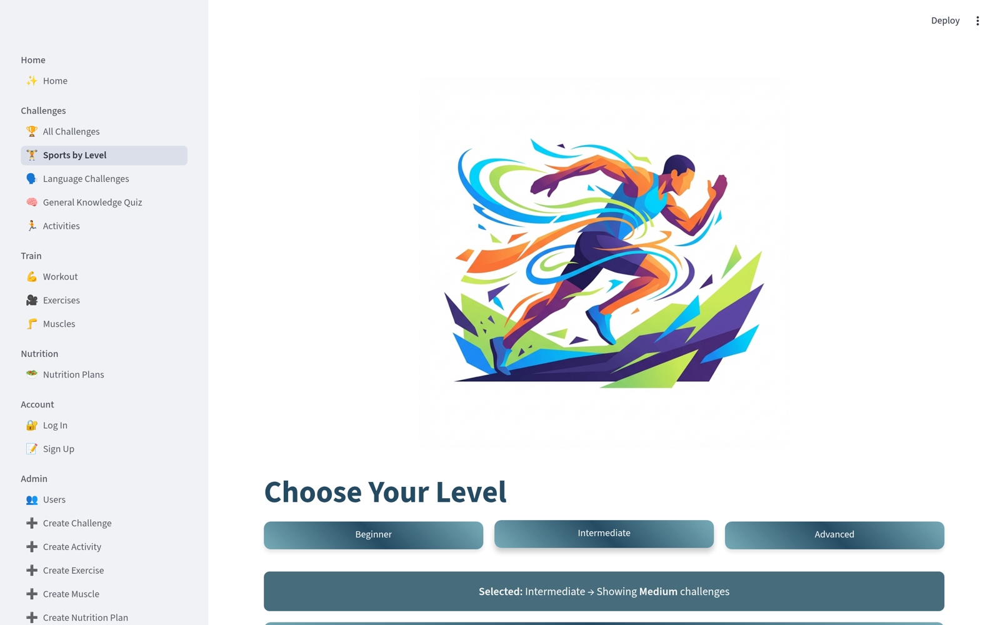
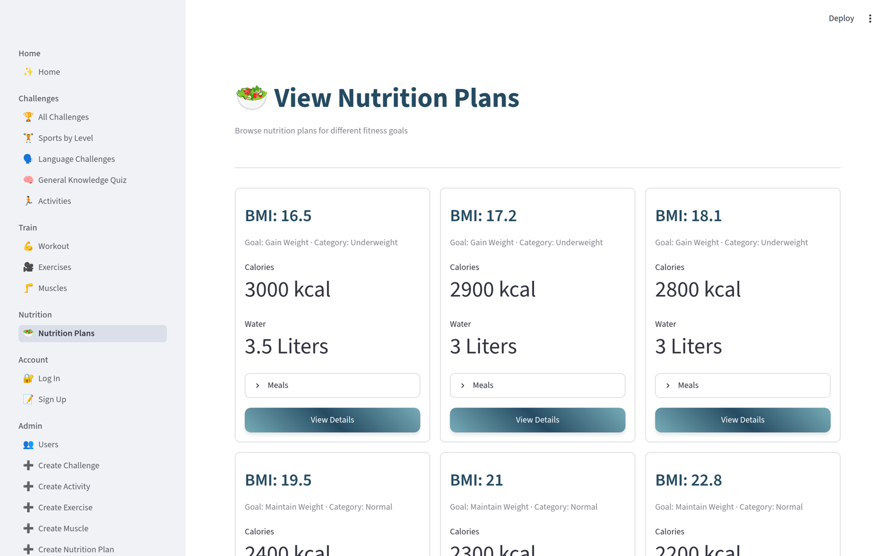

# Software Project Documentation

**NEO Challenge — Daily Challenge**
*One app, three daily habits: train your body, grow your languages, sharpen your mind.*

---

## 1. Project Overview

| Field | Value |
|-------|-------|
| **Project Title** | NEO Challenge |
| **Project Type** | Web App (Python + Streamlit) |
| **Description** | NEO Challenge is a free web app that puts three small daily habits in one place: sports challenges, language activities (English, French, German) and a general knowledge quiz. A student picks a challenge, does a short activity, and comes back tomorrow. It also has a workout and exercise library with 60 real demonstration videos, a muscle explorer, and nutrition plans by BMI category. |
| **Target Users** | Primary: students aged 12-18. Secondary: teachers, parents and schools. Tertiary: sports clubs and youth / language centres. |
| **Resolution / Platform** | Runs in any modern browser. Desktop-first wide layout, tested at 1440x900. Streamlit columns stack on narrow widths, so mobile is partially tested. |
| **Date** | October 2026 |

### Tech Stack

| Category | Technology | Purpose |
|----------|-----------|---------|
| **Language** | Python 3 | All application logic: pages, database queries, routing |
| **Framework** | Streamlit 1.64 | Builds every screen and handles multi-page navigation (`st.navigation`) plus app state (`st.session_state`) |
| **Database** | SQLite via Python's built-in `sqlite3` | Stores users, challenges, activities, questions, muscles, exercises and nutrition plans in `database/database.db` |
| **Libraries** | Streamlit only | `requirements.txt` contains exactly one package: `streamlit`. `sqlite3` and `os` come from the standard library, so nothing else to install. |
| **Styling** | Custom CSS (`assets/styles.css`) + `assets/config.py` | One teal colour system, gradient buttons, rounded cards |

### Dependencies

| Package | Version | Purpose |
|---------|---------|---------|
| streamlit | 1.64 | The whole user interface: widgets, multi-page navigation, session state, video playback |

> No other third-party package is needed. SQLite is built into Python, which is why the whole app runs offline with a single install.


---

## 2. Problem Statement

### What problem does this project solve?

Teenagers who want to improve themselves usually spread their effort across several separate apps: a generic fitness tracker for the gym, a language app for vocabulary, and a quiz app for trivia. Each one is built for adults, most are full of ads or paywalls, and none of them help a young person keep a *small* daily habit going. NEO Challenge gives a student one simple, free place to build three small habits a day: train the body, grow the languages, and sharpen the mind.

### Why does it matter?

Students aged 12-18 are exactly the age group that most needs daily movement, language practice and mental stimulation, and the age group for whom a habit is easiest to build when it is short and in one place. Without one place to return to, effort never becomes a habit. When the habit does not stick, the student does not get fitter, does not speak more languages, and does not read more history and science. Teachers and parents have the same problem from the other side: there is no free tool they can recommend without an adult account.

### How is it currently solved?

Students use separate apps (generic fitness trackers, language-learning apps, trivia apps) or simply follow YouTube workout videos with no structure. The separate apps are designed for adults, are ad-heavy or overwhelming, and cost money. The YouTube route has no plan, no levels and no way to remember what you did last week. Neither route puts the three habits together, so the student has to remember three different places.

---

## 3. Technical Architecture

### Project Structure

```
neo_challenge_database/
├── app.py                      # Entry point: st.navigation router (39 lines)
├── requirements.txt            # One dependency: streamlit
├── assets/
│   ├── config.py               # Colours, difficulty colours, level icons, DB path
│   ├── styles.css              # Custom CSS (buttons, cards, headers, scrollbar)
│   ├── logo.svg
│   └── *.jpg / *.png / *.webp  # Category, muscle and equipment images
├── pages/                      # 23 self-contained Streamlit pages
│   ├── home.py                 # Home hub with three challenge categories
│   ├── view_challenges.py      # Challenge browser
│   ├── challenge_details.py    # Challenge details + level filter + join
│   ├── view_activities.py / _activites_details.py
│   ├── language_challenge.py   # English / French / German challenges
│   ├── general_knowledge.py    # Quiz: level, 10 random questions, score
│   ├── workout.py              # Workout browser by equipment type
│   ├── view_exercise.py / _exercise_details.py   # Exercise library + video
│   ├── view_muscles.py / _muscle_details.py      # Muscle explorer + images
│   ├── view_nutrition_plan.py / _nutrition_plan_details.py
│   ├── sport-challenge.py      # Sports-by-level finder + fitness calculator
│   ├── login.py / sign_up.py / view_users.py
│   └── _create_*.py            # Admin: create challenges, activities, exercises,
│                               #         muscles, nutrition plans
├── database/
│   ├── tables.sql              # Schema for all 9 tables
│   ├── database.db             # Populated SQLite database
│   └── insert_*.sql            # Original seed data written by the team
├── videos/                     # 60 exercise demonstration clips (.mp4)
└── docs/
    ├── neo_challenge_documentation.md
    └── screenshots/            # 11 screenshots used in this document
```

### Architecture Diagram

```
   [ Browser ]
       |  HTTP  (Streamlit websocket)
       v
   [ Streamlit server ]
       |
       +---> app.py  (st.navigation router)
       |         |
       |         +---> pages/*.py   (23 self-contained pages)
       |                   |
       |                   +---> st.session_state  (selected ids, filters, userId)
       |                   +---> st.switch_page()  (page to page navigation)
       |
       +---> [ SQLite: database/database.db ]
       |
       +---> [ Media ]
              assets/  -> images (categories, muscles, equipment)
              videos/  -> 60 exercise demonstration .mp4 clips
```

In plain words: one Python process serves every screen. `app.py` only decides which pages exist and how they are grouped in the sidebar; each page file opens its own short-lived SQLite connection, reads what it needs, closes the connection, and renders. Pages never import each other — they pass the selected item through `st.session_state` and move with `st.switch_page()`.

### Key Files

| File | Purpose | Lines of Code |
|------|---------|:-------------:|
| app.py | Entry point. `st.navigation` router that groups the 23 pages into six sidebar sections: Home / Challenges / Train / Nutrition / Account / Admin. Hidden pages (details) are reached only by navigation. | 39 |
| pages/home.py | Home hub. Three category cards (Sports, Language, General Knowledge), six buttons that navigate on click, and a "How It Works" panel. | 55 |
| pages/challenge_details.py | The busiest page. Loads one challenge, shows metrics, joins the challenge for the logged-in user, filters activities by Easy/Medium/Hard, and links to activities and the quiz. | 136 |
| pages/general_knowledge.py | Quiz engine. Picks 10 random questions for the chosen level, keeps the answers in a `st.form`, then scores them and reviews each question with a check or cross. | 98 |
| pages/workout.py | Four equipment cards (Machines, Bodyweight, Free Weights, Cables). Each button stores an equipment filter and jumps to the exercise library. | 49 |
| pages/view_exercise.py | Exercise library. Shows all exercises (or only the filtered equipment) as a three-column card grid, coloured by difficulty. | 48 |
| pages/sport-challenge.py | Sports-by-level finder (Beginner / Intermediate / Advanced mapped to Easy / Medium / Hard) plus a fitness level calculator from push-ups, squats and plank seconds. | 92 |
| assets/styles.css | The whole look: CSS variables, header colours, teal gradient buttons with 10px radius and hover lift, rounded inputs and messages, scrollbar, image radius. | 106 |
| database/tables.sql | Schema for all 9 tables, including the foreign keys and the `CHECK` constraints on question level and answer letter. | 118 |

---

## 4. Features & User Flow

### Feature List

| # | Feature | Description | Status |
|---|---------|-------------|:------:|
| 1 | Home hub | One landing screen with three category cards — Sports, Language Challenge, General Knowledge — and six buttons into the app. | ✅ |
| 2 | Challenge browser + details | All challenges as cards with levels and activity counts, and a details page with metrics and a description. | ✅ |
| 3 | Easy / Medium / Hard filter | On a challenge page, three level buttons filter the activity list by difficulty, with a banner showing the active filter and a "Clear Filter" button. | ✅ |
| 4 | Join a challenge | "Start Challenge" saves the challenge to the logged-in user in the `user_challenges` join table and shows a success message with balloons. | ✅ |
| 5 | Language challenges | English for Beginners, French Conversation and German Grammar, each with 6 levelled activities. | ✅ |
| 6 | General Knowledge quiz | Choose a level, get 10 random questions, submit once, and see an instant score with a check/cross review of every question. | ✅ |
| 7 | Workout browser by equipment | Machines, Free Weights, Bodyweight and Cables cards that filter the exercise library by equipment type. | ✅ |
| 8 | Exercise library with videos | Every one of the 60 exercises has a real demonstration video, plus the muscle it trains, the equipment and the difficulty. | ✅ |
| 9 | Muscle explorer | 15 muscles, each with an image and muscle group. "View Details" opens the Workout browser to train it. | ✅ |
| 10 | Sports-by-level finder | Pick Beginner / Intermediate / Advanced, get the matching Sports challenges, or let the fitness level calculator suggest a level for you. | ✅ |
| 11 | Nutrition plans by BMI | 15 plans across Underweight, Normal, Overweight and Obese, each with calories, breakfast, lunch, dinner and daily water intake. | ✅ |
| 12 | Sign up / log in | Students create an account (username, email, password, date of birth, height, weight, phone) and log in so joined challenges are saved to them. | ✅ |
| 13 | Admin pages | Create challenges, activities, exercises, muscles and nutrition plans, and view the user list. | ✅ |
| 14 | Password hashing | Passwords are stored in plain text today; hashing is planned so the database never holds a readable password. | ⏳ |
| 15 | Progress tracking over time | Saving daily results so a student can see their streak and improvement week by week. | ⏳ |
| 16 | Public deployment | Putting the app online so it can be opened from any school without installing Python. | ⏳ |

> Status: ✅ Complete | ⏳ In Progress | ❌ Not Started

**Known limitations:** passwords are stored in plain text (a student can read another student's password from the database file), there is no progress history yet, and the app is not deployed publicly — it currently runs locally with `streamlit run app.py`.

### User Flow

```
                         ┌──────────────────┐
                         │  Home            │
                         │  "Daily          │
                         │  Challenge"      │
                         └────────┬─────────┘
                                  │
     ┌───────────┬───────────────┼────────────────┬──────────────────┐
     ▼           ▼               ▼                ▼                  ▼
┌──────────┐ ┌───────────┐ ┌───────────┐ ┌─────────────┐   ┌──────────────┐
│  Sports  │ │  Language │ │   Quiz    │ │   Workout   │   │    All       │
│           │ │           │ │ (General  │ │  (by equip- │   │  Exercises   │
│           │ │           │ │  Knowledge│ │   ment)     │   │              │
└─────┬─────┘ └─────┬─────┘ └─────┬─────┘ └──────┬──────┘   └──────┬───────┘
      │             │             │              │                   │
      ▼             ▼             ▼              ▼                   ▼
┌──────────┐ ┌───────────┐ ┌───────────┐ ┌─────────────┐   ┌──────────────┐
│   All    │ │  Language │ │   Score   │ │  Exercises  │   │   Exercise   │
│Challenges│ │Challenges │ │ + review  │ │  (filtered  │   │  video +     │
│          │ │           │ │  with     │ │   by equip- │   │  muscle info │
│          │ │           │ │  ✅ / ❌   │ │   ment)     │   │              │
└─────┬─────┘ └─────┬─────┘ └───────────┘ └──────┬──────┘   └──────────────┘
      │             │                              │
      ▼             ▼                              │
┌───────────────┐  │                               │
│    Challenge  │  │                               │
│    Details    │  │                               │
│  (level filter│  │                               │
│   + join)     │  │                               │
└───────┬───────┘  │                               │
        │          │                               │
        ▼          ▼                               │
┌───────────────┐  │                               │
│   Activity    │  │                               │
│   Details     │  │                               │
└───────────────┘  │                               │
                                                 (Everywhere above, the
                                                  grouped sidebar in
                                                  app.py is always
                                                  available for jumping
                                                  to any other page.)
```

### Screen Reference

| Screen | File / Route | Description | Transitions To |
|--------|-------------|-------------|----------------|
| Home | pages/home.py | Headline "Daily Challenge", three category cards with images, and the "More Ways to Train" buttons | All Challenges, Language Challenges, General Knowledge Quiz, Workout, Sports by Level, All Exercises |
| All Challenges | pages/view_challenges.py | Every challenge as a bordered card with levels, activity count and category colour | Challenge Details |
| Sports by Level | pages/sport-challenge.py | Three level buttons, a fitness level calculator (push-ups, squats, plank) and a per-challenge expandable | All Challenges (filtered by the chosen difficulty) |
| Language Challenges | pages/language_challenge.py | English, French and German challenge cards with levels and activity counts | Challenge Details |
| General Knowledge Quiz | pages/general_knowledge.py | Level buttons, then a form of 10 multiple-choice questions, then the score and the review | Score is shown in place; "New Quiz" draws a fresh random set |
| Challenge Details | pages/challenge_details.py | Challenge image, levels / activities / duration metrics, description, "Start Challenge" to join, level filter and the activity list | Activities, General Knowledge Quiz (General Knowledge only), Log In (if not signed in), Activity Details |
| Activities | pages/view_activities.py | All activities as cards with category and difficulty | Activity Details |
| Activity Details | pages/_activites_details.py | One activity in full with a "start" action | Back to Activities |
| Workout | pages/workout.py | Four equipment cards: Machines, Free Weights, Bodyweight, Cables | Exercises (filtered by the chosen equipment) |
| Exercises | pages/view_exercise.py | Three-column card grid of exercises with equipment, difficulty and a filter banner | Exercise Details |
| Exercise Details | pages/_exercise_details.py | The muscle trained, equipment, difficulty, written description and the demonstration video | Back to Exercises |
| Muscles | pages/view_muscles.py | Grid of 15 muscle images with group names | Workout |
| Nutrition Plans | pages/view_nutrition_plan.py | Plan cards grouped by BMI category with calories and water intake | Nutrition Plan Details |
| Nutrition Plan Details | pages/_nutrition_plan_details.py | Full breakfast / lunch / dinner breakdown for one plan | Back to Nutrition Plans |
| Log In | pages/login.py | Email and password form; on success stores the user id in the session | Stays on the page with a success message (the sidebar leads anywhere next) |
| Sign Up | pages/sign_up.py | Registration form for a new student account | Account created, ready to log in |
| Users (Admin) | pages/view_users.py | List of registered users | — |

---

## 5. UI/UX Design

### Screenshots

**Home**: the "Daily Challenge" headline with three category cards — Sports, Language Challenge and General Knowledge — plus the "More Ways to Train" buttons.


**Workout by equipment**: four cards, one per equipment type, each with a photo and a button that filters the exercise library.


**Exercise library**: a three-column grid of exercise cards showing equipment and difficulty, with the active filter as a banner above.


**Exercise demonstration video**: the muscle being trained, equipment, difficulty, the written description and the real video clip.


**Muscle explorer**: muscle cards with images and muscle group names.


**Language challenges**: cards for English, French and German with levels and activity counts.


**Challenge details**: the challenge image, three metrics (levels, activities, duration), the join button, and the Easy / Medium / Hard level filter.


**Quiz**: pick a level, answer 10 multiple-choice questions in one form.


**Quiz result**: the score out of 10 and a per-question review showing the student's answer next to the correct one.


**Sports by level**: the Beginner / Intermediate / Advanced buttons and the fitness level calculator.



**Nutrition plans**: plan cards with the BMI category, goal, calories and water intake.



### Design System

The app uses one calm teal-blue palette defined once in `assets/config.py` and reused by `assets/styles.css`, so the colours never drift between pages.

| Element | Style |
|---------|-------|
| **Primary Colour (dark)** | `#254B62` — titles, button gradient end, Language category |
| **Primary Colour (light)** | `#77ABB7` — button gradient start, Easy level, Sports category |
| **Medium Colour** | `#476D7C` — Medium level, General Knowledge category |
| **Deep Colour** | `#1D3E53` — Hard level (the darkest shade) |
| **Difficulty Colours** | Easy `#77ABB7` / Medium `#476D7C` / Hard `#1D3E53` |
| **Level Icons** | 🟢 Easy · 🟡 Medium · 🔴 Hard — so level is readable without relying on colour alone |
| **Font** | Streamlit default sans-serif |
| **Button Style** | Teal gradient `linear-gradient(45deg, #77ABB7, #254B62, #77ABB7)`, white bold text, 10px rounded corners, and a 2px lift on hover |
| **Cards** | Streamlit bordered containers, 8px radius, with images also rounded to 8px |
| **Badges** | Difficulty shown as a fully rounded pill tag coloured by level |
| **Layout** | Wide layout with grouped sidebar navigation (Home / Challenges / Train / Nutrition / Account / Admin) and a 1200px maximum content width |

The whole system is carried by eight CSS variables in `assets/styles.css`, so changing the palette means editing one block instead of hunting through 23 pages.

### Responsive Design

| Breakpoint | Layout | Tested? |
|------------|--------|:-------:|
| Desktop (1440x900) | Wide layout, grouped sidebar on the left, three-column card grids for categories, workouts, exercises and muscles | ✅ |
| Tablet (768-1024px) | Same wide layout; narrower columns, sidebar still visible | ☐ |
| Mobile (< 768px) | Streamlit stacks the three columns vertically so each card takes the full width; navigation still works but was only checked briefly | ⚠️ Partially |

---

## 6. Data Sources

### Data Sources

| Source | Type | Description |
|--------|------|-------------|
| `database/database.db` | SQLite Database | The single source of truth: users, challenges, activities, questions, muscles, exercises, nutrition plans and the two join tables |
| `database/insert_*.sql` | Static (SQL seed files) | Original seed data written by the team: 12 challenges, 18 language activities, 60 trivia questions, 15 muscles, 60 exercises, 15 nutrition plans, 15 sample users |
| Sign up form | User Input | New accounts: username, email, password, date of birth, height, weight, phone |
| Join Challenge button | User Input | Rows written into the `user_challenges` join table for the logged-in student |
| Admin pages | User Input | Challenges, activities, exercises, muscles and nutrition plans created from inside the app |
| Quiz answers | User Input | The 10 selected answers per quiz, graded in the browser session and not stored |
| `assets/` | Static (images) | Category art, muscle images, equipment photos, logo |
| `videos/` | Static (.mp4) | 60 exercise demonstration clips, one per exercise |

There are **no external APIs** — no accounts to create, no keys to store, and nothing that can break when a third-party service is down. The database is populated by running the `insert_*.sql` files, so every row in the app can be traced back to a file the team wrote.

### Database Schema

| Table | Columns | Description |
|-------|---------|-------------|
| `users` | id, username, email, password, DOB, height, weight, phone, ssn, created_at | Student accounts; email is unique (password is plain text today) |
| `challenges` | id, name, number_of_levels, number_of_activities, category, duration, description, created_at | 12 challenges: 8 Sports, 3 Language, 1 General Knowledge |
| `activities` | id, name, description, category, difficulty, challenge_id, created_at | 18 levelled activities, 6 for each language challenge, Easy / Medium / Hard |
| `questions` | id, question, option_a…option_d, correct_answer, level, challenge_id, created_at | 60 trivia questions with 4 options; `CHECK` keeps `correct_answer` to A-D and `level` to Easy / Medium / Hard |
| `user_challenges` | user_id, challenge_id | Join table linking students to the challenges they joined |
| `Nutrition_Plans` | id, bmi, category, goal, calories, breakfast, lunch, dinner, water_intake, created_at | 15 plans across Underweight / Normal / Overweight / Obese |
| `User_Nutrition_Plans` | user_id, nutrition_plan_id | Join table linking students to their chosen nutrition plan |
| `muscles` | id, name, latin_name, description, muscle_group, location, function, origin, insertion, muscle_type, difficulty_to_train, image_url, video_url, created_at, updated_at | 15 muscles, each with anatomy notes and an image |
| `exercises` | id, muscle_id, name, description, equipment_needed, difficulty, video_url | 60 exercises; every one has a video, a muscle and an equipment type (Machine 18, Free Weights 20, Cable 12, Bodyweight 10) |

Foreign keys tie the app together: `activities.challenge_id` → `challenges`, `questions.challenge_id` → `challenges`, `exercises.muscle_id` → `muscles`, and both join tables point back at `users`. That is what lets every exercise show the name of the muscle it trains.

### External APIs

| API | Purpose | Rate Limit |
|-----|---------|------------|
| None | All data is local: an SQLite file plus static assets and local videos | N/A |

---

## 7. Educational Content

### Learning Objectives

By the end of this project, the student will be able to:

1. **Build a multi-page Python web app with Streamlit** — turn 23 separate scripts into one app with a real navigation model (`st.navigation` groups, hidden detail pages, `st.switch_page`), instead of one long file.
2. **Design and query a relational database** — model 9 SQLite tables with primary keys, foreign keys, two join tables and `CHECK` constraints, then query them with joins and filters instead of hard-coding content.
3. **Manage app state and navigation** — use `st.session_state` deliberately to carry the selected challenge, activity, exercise, muscle, nutrition plan, equipment filter, difficulty filter and logged-in user between pages.
4. **Organise and seed real content** — write original SQL seed files for 12 challenges, 60 exercises with 60 matching videos, 60 trivia questions, 15 muscles and 15 nutrition plans, and keep the ids consistent between tables.
5. **Document and present a software project** — write this documentation, choose a design system, and explain the architecture and user flow to judges and teachers.

### Cultural / Historical Context

| Topic | Description |
|-------|-------------|
| Multilingual learning | Arabic-speaking students learning English, French and German in the same place. The three language challenges let a student practise whichever language the school teaches, at Easy, Medium or Hard level. |
| Healthy-lifestyle awareness for teens | Fitness and nutrition content aimed at 12-18 year olds rather than adults: home workouts, bodyweight exercises, stretching and yoga, and nutrition plans matched to a BMI category with realistic water targets. |
| World history and science | The 60 general knowledge questions draw on world history and science — for example which country invented paper and who was the first person to walk on the Moon — so screen time produces learning, not just a score. |

### Curriculum Alignment

| Skill Area | What the Student Practices |
|------------|---------------------------|
| Problem Solving | Turning a real observation ("teenagers use several separate apps for fitness, languages and trivia") into a product decision: keep every task short, keep it free, keep it in one place. |
| Computational Thinking | Data modelling and SQL: 9 tables, foreign keys, two many-to-many join tables, difficulty filtering, `order by random()` for the quiz, and a small fitness-level formula (push-ups + squats + plank/10). |
| Creativity | The visual design system — a teal palette chosen in `assets/config.py`, difficulty colour coding, gradient buttons, rounded cards, and a 60-clip exercise catalogue with matching muscle illustrations. |
| Collaboration | A three-person team working through Git and GitHub: separate commits per feature and merging branches. |
| Technical Writing | Writing this document: architecture diagram, screen reference table with real page transitions, honest known limitations, and verified data counts read straight from the database. |

---

## 8. Marketing Plan

> **Short version** — for full marketing plans, use the main Afro-Asian template.

### Target Audience

- **Primary**: students aged 12-18 who want to build small daily habits around fitness, languages and general knowledge
- **Secondary**: teachers, parents and schools who want a free, safe tool to recommend to students
- **Tertiary**: sports clubs and youth / language centres that need material for training sessions

### Platforms

- Web browser on school computers and laptop labs
- Personal laptops
- Phones (the layout stacks for narrow screens, so a phone works for the quiz and the exercise videos)

### Promotion Ideas

1. **Live demo** at the Afro-Asian Tech Forum and at the school science fair — run the quiz against the audience and show one exercise video.
2. **Short demo video** (about a minute) showing the quiz and one workout video, so the app explains itself in under a minute.
3. **Instagram / TikTok posts** with screenshots and a weekly "challenge of the week" that anyone can try offline the same day.
4. **Poster with the tagline** — "One app, three daily habits" — in school corridors, at the sports club and in the language centre.
5. **Class-vs-class quiz competitions** run by teachers, using the Easy / Medium / Hard levels so every class has a fair chance.
6. **Share with school PE and language teachers**, who can use the exercise library and the language activities directly in a lesson.

---

## 9. Student Worksheet

> **Instructions**: This section is filled in for the NEO Challenge project.

---

### My Project Information

**Student Name**: NEO Challenge Team

**Project Title**: NEO Challenge

**Date**: October 2026

---

#### What is your project about?

NEO Challenge is a free web app for students aged 12-18. It puts three daily habits in one
place: sports challenges, language activities in English, French and German, and a general
knowledge quiz. It also has a workout and exercise library with 60 real demonstration videos,
a muscle explorer, and nutrition plans matched to BMI category. The tagline is "One app, three
daily habits: train your body, grow your languages, sharpen your mind."

---

#### What problem does it solve?

Teenagers split self-improvement across separate adult apps — a fitness tracker, a language app
and a quiz app — which are ad-heavy, sometimes paid, and impossible to keep a habit with.
NEO Challenge is one simple, free place where a student can finish a short challenge, a short
language activity or a short quiz every day.

---

### My Tech Stack

**My project type** (circle one): Web App / Desktop App / Mobile App / Python Script / Other: _______

**Technologies I used**:

| Category | Technology |
|----------|-----------|
| Language | Python 3 |
| Framework | Streamlit 1.64 |
| Database | SQLite (Python's built-in `sqlite3`) |
| Libraries | Streamlit only, plus custom CSS in `assets/styles.css` |

---

### My Screens

Draw or describe all the screens in your project:

| Screen Name | What the user sees/does | How to get here |
|-------------|------------------------|-----------------|
| Home | "Daily Challenge" headline, three category cards, "More Ways to Train" buttons | Opens by default |
| All Challenges | Cards for all 12 challenges with levels, activity counts and category colour | Home → Start Sports Challenge |
| Challenge Details | Image, metrics, join button, Easy/Medium/Hard filter, activity list | All Challenges → pick a challenge |
| Activity Details | One activity in full with a start action | Challenge Details → Start Activity |
| Language Challenges | English, French and German challenge cards | Home → Start Language Challenge |
| General Knowledge Quiz | Level buttons, then 10 questions, then the score | Home → Start General Knowledge Challenge |
| Quiz Result | Score out of 10 and a check/cross review of each answer | Submit Answers on the quiz |
| Workout | Four equipment cards (Machines, Free Weights, Bodyweight, Cables) | Home → Workout by Equipment |
| Exercises | Three-column grid of exercises, filtered by equipment | Workout → pick an equipment type |
| Exercise Details | Muscle, equipment, difficulty, description and video | Exercises → View Details |
| Muscles | Grid of 15 muscle images and groups | Sidebar → Muscles |
| Sports by Level | Level buttons plus fitness level calculator | Home → Fitness Level Test |
| Nutrition Plans | Cards with BMI category, goal, calories and water | Sidebar → Nutrition Plans |

---

### My Features

| Feature | What it does | Status |
|---------|-------------|:------:|
| Home hub | Three challenge categories on one screen | ✅ |
| Challenge browser and details | Browse 12 challenges and read each one | ✅ |
| Level filter | Show only Easy, Medium or Hard activities | ✅ |
| Join a challenge | Saves the challenge to the logged-in student | ✅ |
| Language challenges | English, French, German with 6 levelled activities each | ✅ |
| General knowledge quiz | 10 random questions per level, instant score with review | ✅ |
| Workout browser | Filter exercises by equipment type | ✅ |
| Exercise library | 60 exercises, each with a real demonstration video | ✅ |
| Muscle explorer | 15 muscles with images, linked to the Workout browser | ✅ |
| Sports-by-level finder | Beginner / Intermediate / Advanced plus a fitness calculator | ✅ |
| Nutrition plans | 15 plans by BMI category with meals and water intake | ✅ |
| Sign up and log in | Student accounts so joined challenges are saved | ✅ |
| Admin pages | Create challenges, activities, exercises, muscles, plans | ✅ |
| Password hashing | Passwords are plain text today | ⏳ |
| Progress tracking | Saving daily results over time | ⏳ |
| Public deployment | Putting the app online | ⏳ |

---

### My Data

**Where does data come from?**

From our own SQL seed files. We wrote `insert_challenges.sql`, `insert_activities.sql`,
`insert_general_knowledge.sql`, `insert_musles.sql`, `insert_exercise.sql`,
`insert_nutrition_plan.sql` and `insert_users.sql`, then loaded them into `database/database.db`
with the `sqlite3` command line tool. Everything is original content written by our team. The
exercise videos are 60 `.mp4` clips we collected and stored in `videos/`. There are no
external APIs, so the app works with no internet connection.

**What data is stored?**

9 SQLite tables. 12 challenges (8 Sports, 3 Language, 1 General Knowledge), 18 language
activities (6 per language challenge, Easy / Medium / Hard), 60 trivia questions (10 Easy, 20
Medium, 30 Hard), 15 muscles with images, 60 exercises each linked to a muscle and an equipment
type and having a video (Machine 18, Free Weights 20, Cable 12, Bodyweight 10), 15 nutrition
plans across Underweight / Normal / Overweight / Obese, 15 sample users, and two join tables
(`user_challenges`, `User_Nutrition_Plans`). User answers in the quiz are graded in the session
and are not stored.

---

### What I Learned

1. **The hardest part of building my project was:** keeping the data consistent. After we
   re-seeded the database, some exercises pointed at the wrong muscle ids, so the muscle page
   showed the wrong exercises. We had to fix the ids and remove the activities of challenges we
   had deleted. We learned that foreign keys are only useful if the ids we insert really match.

2. **The most fun part of building my project was:** collecting the 60 exercise videos and linking
   each one to the right muscle and equipment, and writing the 60 quiz questions. Once the videos
   played inside the app, the whole project felt real.

3. **If I had more time, I would add:** progress tracking over time so a student can see a streak,
   password hashing so passwords are never stored in plain text, and a public deployment so
   anyone can open the app from a link.

4. **One thing I would do differently:** plan the database ids and the page navigation *before*
   seeding any data. We seeded first and then had to restructure, which meant fixing ids and
   re-checking every page link.

---

### Screenshot of My Project


---

**Instructor Notes**:

_______________________________________________
_______________________________________________

---

<div class="session-footer">
  <p>Techno Kids, Techno Future — Software Documentation Template</p>
  <p>Afro-Asian Tech Forum · Software Category · 2026</p>
</div>